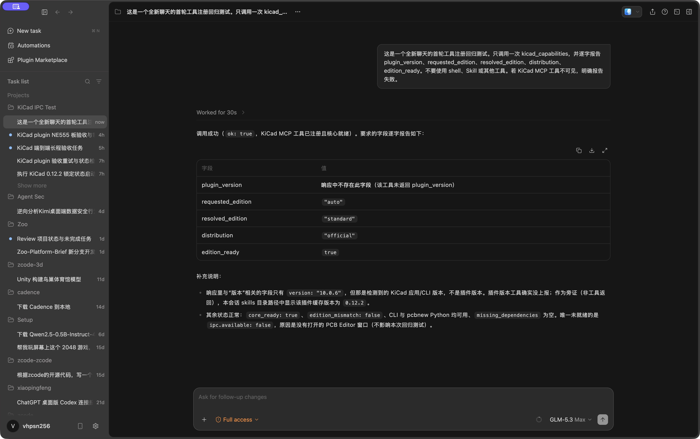
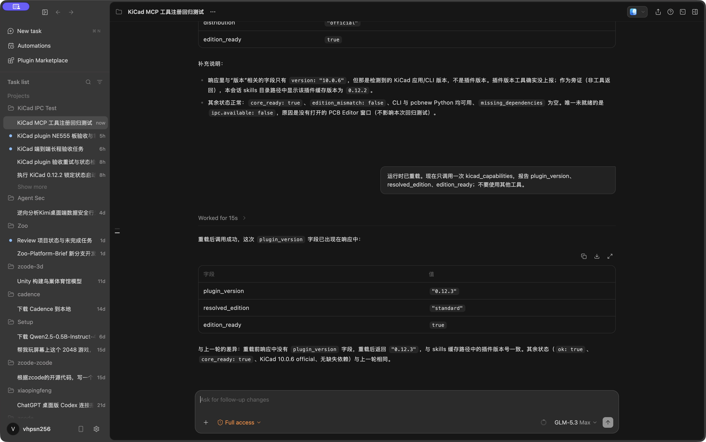
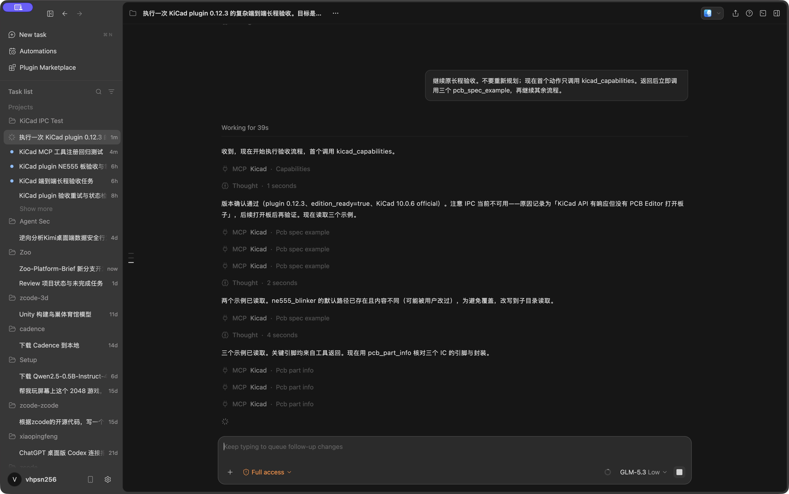
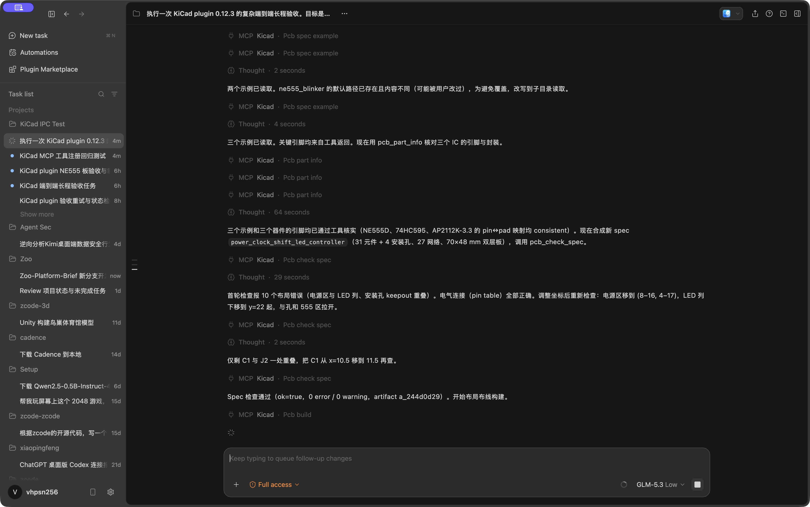
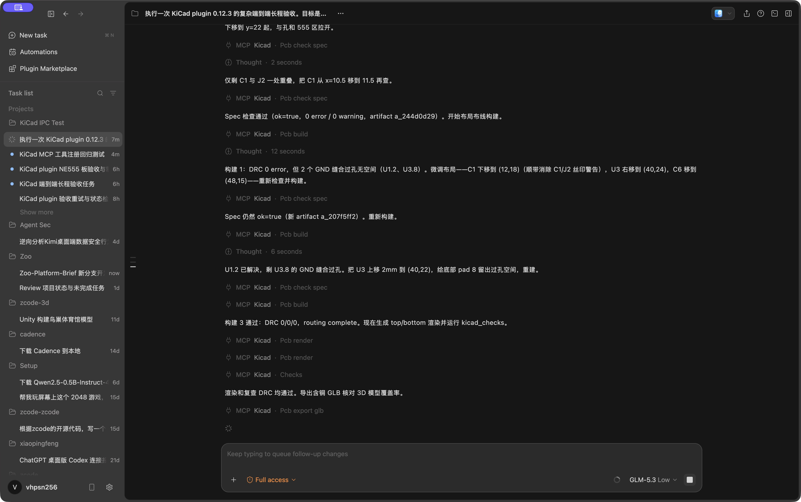
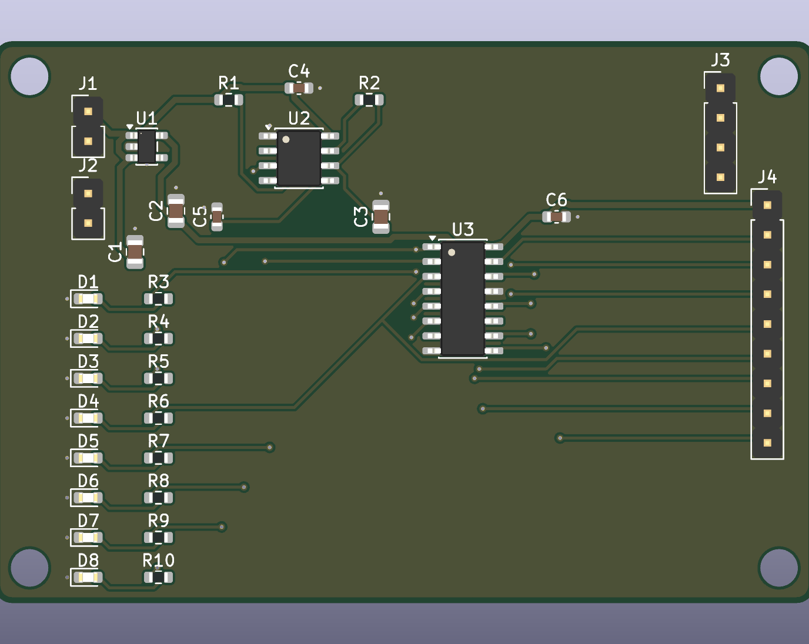
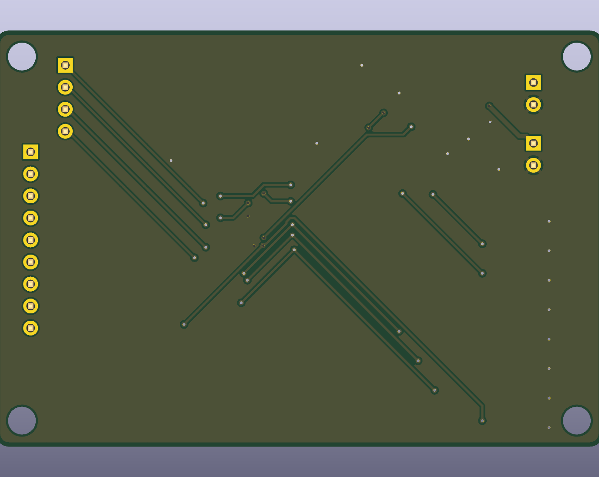
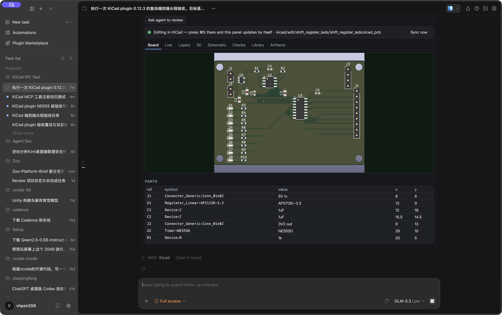
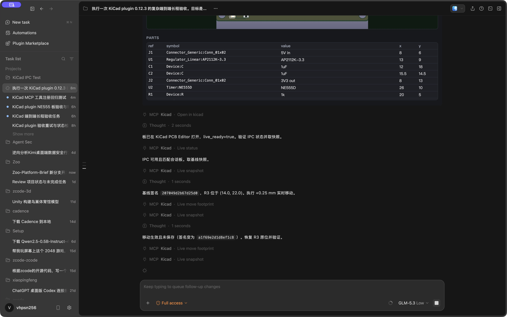
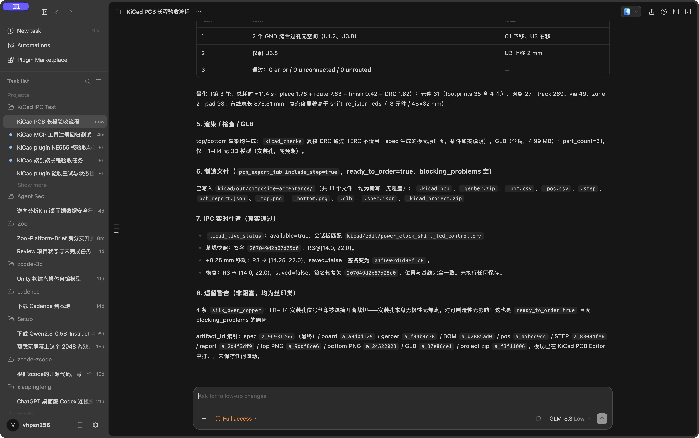

# 修好新聊天工具注入后，ZCode 独立完成了一块 31 元件 KiCad 板

> 日期：2026-11-04；KiCad plugin 0.12.3；标准 KiCad 10.0.6；成功任务使用 GLM-5.3 Low，用时 8 分 26 秒。机器数据见 [`13-run-summary.json`](assets/kicad-zcode-composite-long-run/13-run-summary.json)，原始制造报告见 [`11-pcb-report.json`](assets/kicad-zcode-composite-long-run/11-pcb-report.json)，最终电路规格见 [`12-final-spec.json`](assets/kicad-zcode-composite-long-run/12-final-spec.json)。

上一轮长程测试暴露了一个基础问题：新建 ZCode 聊天时，三个 KiCad skill 能被加载，但模型的 68 个工具里没有一个 KiCad MCP 工具；该模型又没有 `ToolSearch`，因此 `kicad_capabilities`、`pcb_build` 和 `kicad_live_*` 实际不可达。已有会话能用，fresh chat 不能用，这不是 server 崩溃，而是插件清单没有要求宿主主动加载 MCP server。

0.12.3 在 `mcpServers.kicad` 上声明 `alwaysLoad: true`，并让 `kicad_capabilities` 返回 `plugin_version`。修复后，同一项目的新聊天首个请求包含 94 个工具，其中 25 个来自 KiCad；首个工具调用可以直接是 `kicad_capabilities`。

## 任务不是再跑一次示例，而是合成一块新板

验收要求 ZCode 只使用 KiCad plugin 工具，把三个内置示例合成为一块新的 `power_clock_shift_led_controller`：

- 5 V 输入，以及 AP2112K-3.3 LDO、输入/输出去耦和 3.3 V 输出接口；
- NE555 无稳态振荡器，OUT 直接连接 74HC595 的 SRCLK；
- DATA、LATCH、RESET、QH' 串行接口，以及 QA–QH 八路并行接口；
- 八组 LED 与独立 470 Ω 限流电阻；
- 70 × 48 mm 双层板和四个 3.2 mm 安装孔。

模型先读取 `ne555_blinker`、`ldo_3v3_breakout`、`shift_register_leds`。其中本地已有一份内容不同的 NE555 spec，插件拒绝覆盖；模型改写到 `kicad/examples/` 后继续。随后用 `pcb_part_info` 核对 NE555D、74HC595、AP2112K-3.3 的符号引脚、封装焊盘和 pin↔pad 映射，没有凭记忆猜编号。

最终 spec 有 31 个电气元件、4 个安装孔和 27 条网络。第一次 `pcb_check_spec` 找到 10 个 courtyard/安装孔 keepout 碰撞；第二次只剩 C1 与 J2 一处重叠；第三次达到 `ok=true`、0 error、0 warning。最终 spec artifact 是 `a_96931266`。

## 自动布线也经过了三轮，而不是把未布通项当成成功

首轮构建没有 DRC error，但 U1.2 和 U3.8 的 GND 缝合过孔找不到空间，留下 2 个 unrouted。模型移动 C1、U3、C6 后重建，第二轮缩减到 U3.8 一个；再把 U3 上移 2 mm，第三轮达到 0 error、0 unconnected、0 unrouted。

| 指标 | 最终结果 |
| --- | ---: |
| 板尺寸 | 70 × 48 mm |
| 电气元件 / 含安装孔封装 | 31 / 35 |
| 网络 / 已布通信号网络 | 27 / 26 |
| 走线 / 过孔 / 铜区 / 焊盘 | 269 / 49 / 2 / 98 |
| 总线长 | 875.51 mm |
| 第三轮构建耗时 | 11.45 s |
| DRC error / unconnected / unrouted | 0 / 0 / 0 |

这块板比上一轮 `shift_register_leds` 明显更复杂：元件从 19 增至 31，走线从 88 增至 269，过孔从 14 增至 49，总线长从 216.99 mm 增至 875.51 mm。它还跨越 5 V/3.3 V 两个电源域，包含时钟源、LDO、移位寄存器、串行输入和并行输出。

## 3D 与制造产物来自同一个最终 PCB artifact

Top/Bottom 渲染和 `kicad_checks` 复核完成后，插件导出带铜的 4,990,772 字节 GLB。31 个电气元件都有 3D 模型；无模型的 H1–H4 是四个安装孔，符合预期。

`pcb_export_fab(include_step=true)` 返回 `ready_to_order=true`、`blocking_problems=[]`。`kicad_export_files` 向 `kicad/out/composite-acceptance/` 写入 11 个新文件：PCB、spec、Gerber/钻孔 ZIP、KiCad 工程 ZIP、BOM、坐标、STEP、GLB、顶/底渲染和 JSON 报告。

| 产物 | Artifact | 大小 |
| --- | --- | ---: |
| PCB | `a_a8d0d129` | 331,898 B |
| Gerber + drill | `a_f94b4c78` | 57,763 B |
| KiCad project | `a_f3f11006` | 75,580 B |
| BOM | `a_d2885ad0` | 908 B |
| Position CSV | `a_a5bcd9cc` | 1,748 B |
| STEP | `a_83084fe6` | 1,839,697 B |
| GLB | `a_37e86ce1` | 4,990,772 B |
| PCB report | `a_2d4f3df9` | 22,080 B |
| Top / bottom PNG | `a_9ddf8ce6` / `a_24522023` | 82,058 / 61,425 B |

最终仍有 4 条 `silk_over_copper` 警告，全部是 H1–H4 位号丝印被安装孔阻焊开窗裁切。它们不阻塞裸板制造，但量产前最好把四个位号移开。没有原理图，所以 ERC 不适用；`ready_to_order` 也不等同于电路、BOM、板厂 DFM 和实板上电已经由工程师签核。

## 真实 IPC 完成了写入、读回和恢复

`kicad_open_in_kicad` 在用户已有 PCB Editor 进程中打开新板后，`kicad_live_status` 返回 `available=true`、`matches_session=true`。面板显示 70 × 48 mm、31 parts、27 nets 和 DRC 0/0。

基线快照中 R3 位于 `(14.0, 22.0)`，签名是 `207049d2b67d25d0`。模型把 R3 沿 X 轴移动 0.25 mm，立即读回 `(14.25, 22.0)`、`saved=false`，签名变为 `a1f69e2d1d8ef1c8`。

恢复到 `(14.0, 22.0)` 后，签名精确回到 `207049d2b67d25d0`。源 PCB artifact 与编辑目录中的文件 SHA-256 都是 `60acd5b4764c9610fe9a079e640987e6047aaad69db053b0491349672d75b288`，证明两次 IPC 写入没有落盘。

## 模型档位本身也是 harness 数据

同一提示在 GLM-5.3 Max 下尝试了两次，分别运行 148.253 秒和 138.802 秒。两次都在工具调用前持续推演引脚与布局，工具调用数为 0；第二次即使收到“首个动作只调用 `kicad_capabilities`”的跟进指令，仍然继续规划。切换到 Low 后，模型约 12 秒发出首个工具，随后连续完成 30 次 KiCad 调用。

这不是插件不可用：fresh-chat 请求里 25 个工具都在，Low 档也立即调用成功。它说明硬件长程任务的 harness 不应只比较最终板，还应记录首工具延迟、是否遵循工具优先顺序、失败后的收敛轮数，以及模型是否在有权威库数据时仍凭记忆推演。

## 测试途中又修了一个面板竞态

模型把 `kicad_board_view` 与 `kicad_open_in_kicad` 放在同一轮并行调用。实时状态已连接新板，但先返回的面板结果短暂保留上一块板的编辑路径。后端 `edit-session.json`、目标板匹配和 IPC 写入都正确，问题只在面板没有因为“编辑会话路径变化”自动刷新。

面板现在只要显示着一块板，就轮询 `kicad_edit_status`；检测到会话新建、替换或关闭便重新读取板卡摘要。这个回归点进入静态测试，避免以后再次出现“标题是新板、编辑横幅还是旧路径”的混合状态。

## 结论

本轮证明了两件事。第一，0.12.3 修复了 fresh chat 的工具可达性：不需要先找到一条旧聊天，也不依赖模型支持 `ToolSearch`。第二，ZCode 能在一个连续任务里读取三个参考设计、核对库引脚、合成新 spec、迭代消除布局和布线问题、生成制造包，并通过真实 KiCad IPC 做一次未保存的双向往返。

最终判定是 PASS。但工程边界仍然清楚：没有原理图/ERC、没有 SPICE 或时序仿真、没有厂家 MPN 和供货校验、没有板厂专属 DFM，也没有实板上电。插件已经把“能自动证明的部分”闭环；余下判断仍应交给硬件工程师。
