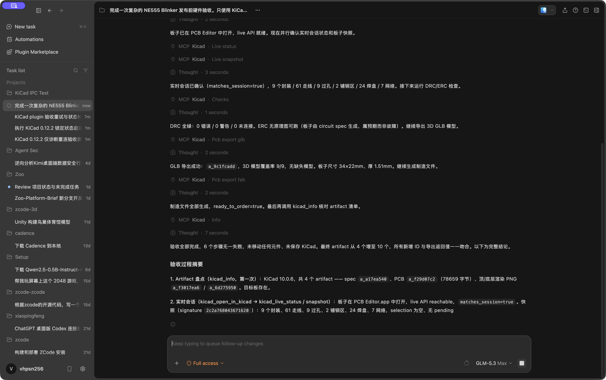
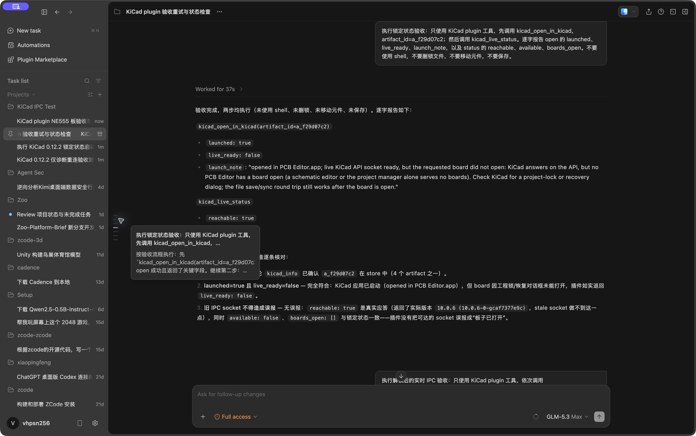
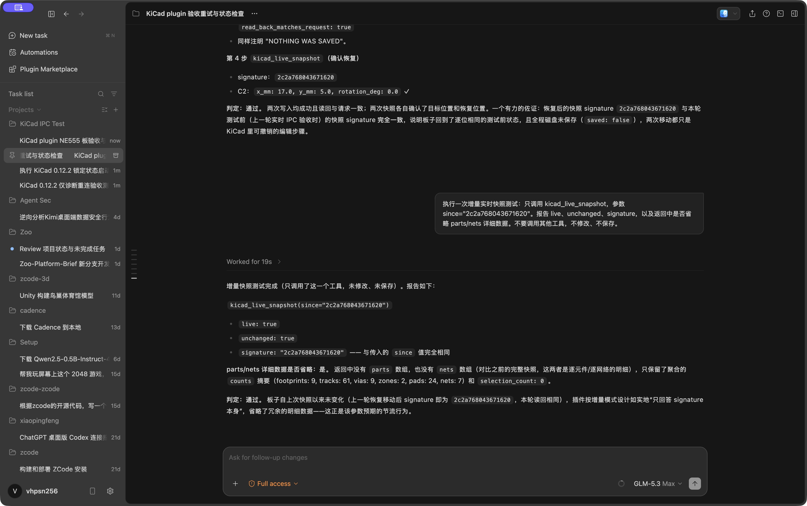
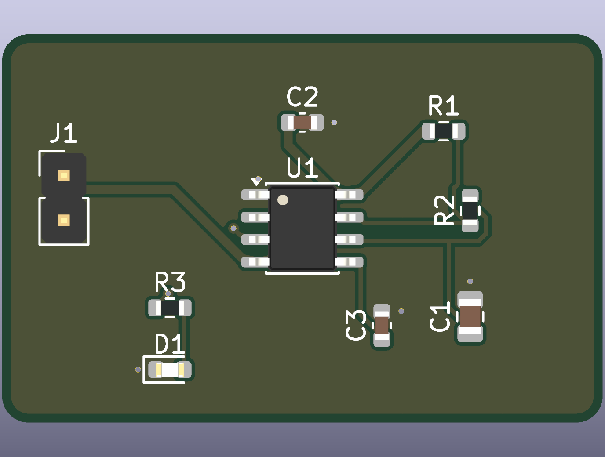
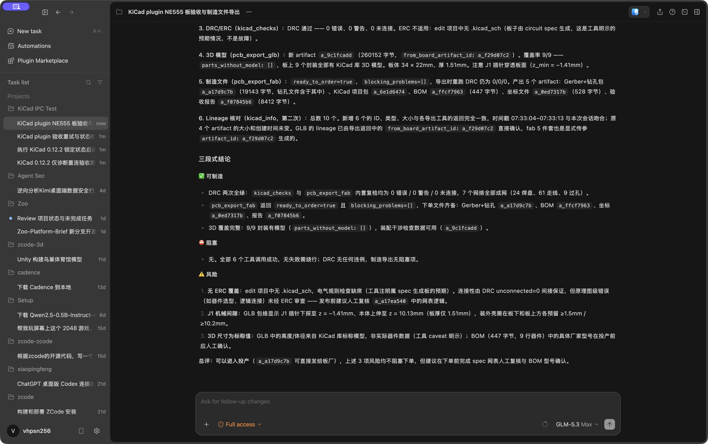

# 让 ZCode 真正操作 KiCad：从实时 IPC 到制造文件的端到端验收

> 验收对象：ZCode KiCad plugin 0.12.2；环境：macOS、ZCode Dev、KiCad 10。本文记录的是一次真实的 Agent 长程任务，不是单元测试截图合集。

硬件 Agent 的演示很容易停在“生成了一份看起来像 PCB 的文本”。真正有用的插件还要回答另外几个问题：它能不能找到用户实际安装的 EDA？能不能确认自己连到的是当前工程，而不是另一个 KiCad 窗口？一次实时改动能不能被立即读回、撤回并保持未保存？最后，DRC、3D 模型和制造文件能不能形成同一条可追溯链路？

这次验收围绕一块 NE555 闪烁灯板展开。ZCode 只使用 KiCad plugin 提供的工具，依次打开真实 PCB Editor、读取实时快照、执行检查、导出 3D 模型和制造文件，并在结束时核对产物谱系。最终结果是：目标板实时连接成立，DRC 为 0 错误 / 0 警告 / 0 未连接，9 个封装全部进入 GLB，制造包没有阻塞项。



## 为什么不能只看 “socket 可达”

KiCad 10 的实时 API 通过本机 Unix socket 提供。最容易出现的误判是：API 能响应，甚至能返回 KiCad 版本，但用户要求打开的板子因为工程锁或恢复对话框并没有真正进入 PCB Editor。

因此插件把结果拆成两层：

- `launched` 只说明精确的 PCB Editor 子进程已经启动；
- `live_ready` 还要求这个进程的 socket 可用，并且 `boards_open` 中确实存在本会话导出的目标板。

锁定态测试正好覆盖了这个边界。截图中进程已启动，API 也真实响应了 KiCad 10.0.6，但 `available=false`、`boards_open=[]`，所以 `live_ready=false`。插件没有把“旧 socket 还活着”或“另一个 KiCad 窗口存在”误报为目标板已连接。



这条判断对 Agent 很重要。文件导出可以继续工作，但任何实时写操作都必须等到目标板匹配后才能执行；否则一次看似无害的元件移动，就可能落在用户正在编辑的另一块板上。

## 一个插件，对接两种 KiCad 发行版

插件提供 `auto`、`standard`、`huaqiu` 三种选择。默认的 `auto` 会在系统和用户 Applications 目录发现 KiCad 10，读取安装内容识别标准版或华秋版，再选择与请求匹配的最新版本。用户显式填写 app 路径时，该路径严格优先，配置错误不会被静默回退掩盖。

两种发行版共用同一套 PCB 生成、检查、渲染、导出和实时 IPC 能力；华秋版额外开放公共器件数据库的只读搜索、详情、供货和模型比较工具。它复用发行版中已经标准化的 `@huaqiu/part-search`，但不会启动 DSH 作为第二套 Agent harness。这样，ZCode 保持唯一的任务编排者，华秋能力作为受约束的工具进入同一条证据链。

自动识别、显式版本选择和缺失依赖都有结构化结果。基础实时用例已经分别在标准 KiCad 10.0.6 和华秋 KiCad 10.0.7 上完成：进程/socket 选择、快照、移动 0.25 mm、立即回读、移回原位，全程不保存。本次更长的制造验收任务运行在标准 KiCad 10.0.6；华秋版没有被这一条长程任务重复覆盖，因此不把两者混写成同一项证据。

## 实时写入必须可读回、可恢复、默认不保存

插件有意只提供一个实时写工具：`kicad_live_move_footprint`。它一次只移动一个封装，可选修改角度，在 KiCad 中形成一个可撤销步骤，但不调用保存。读取则由 `kicad_live_snapshot` 完成，避免用“原地移动”探测位置而污染撤销历史。

验收时先读取 C2 的位置 `(17, 11)`，再把 X 坐标改为 `17.25`，立即读取到新位置，最后移回 `17`。恢复后的签名是 `2c2a768043671620`；以该签名再做增量快照，结果是 `unchanged=true`，详细对象被省略。磁盘上的板文件哈希在任务前后保持一致，证明这组 IPC 操作没有偷偷保存。



这种约束比“Agent 可以控制 GUI”更重要：用户仍然在 KiCad 里看到变化、决定是否接受，并由自己按下保存；插件不会夺走工程文件的最终控制权。

## 长程任务：从当前板到可制造产物

用于验收的 NE555 板是 34 mm × 22 mm、双层，共 9 个封装、61 条走线、9 个过孔、2 个铜区、24 个焊盘和 7 个网络。



ZCode 在一个连续任务中完成了六步：

1. 用 `kicad_info` 建立初始产物清单；
2. 用 `kicad_open_in_kicad` 打开指定 PCB artifact；
3. 用 `kicad_live_status` 和 `kicad_live_snapshot` 校验目标会话与实时板状态；
4. 用 `kicad_checks` 执行 DRC；
5. 用 `pcb_export_glb` 验证 3D 模型覆盖；
6. 用 `pcb_export_fab` 生成 Gerber/钻孔、KiCad 工程、BOM、坐标文件和制造报告，再用 `kicad_info` 核对新增产物。

结果如下：

| 检查项 | 结果 |
| --- | --- |
| 实时会话 | `matches_session=true`，目标板计数与 artifact 一致 |
| DRC | 0 errors、0 warnings、0 unconnected |
| ERC | 不适用；该输入只有 PCB，没有原理图 |
| 3D | 9/9 封装有模型，无缺失模型 |
| 制造包 | `ready_to_order=true`，`blocking_problems=[]` |
| 新增产物 | GLB、Gerber/钻孔、工程、BOM、坐标文件、制造报告，共 6 项 |



“通过”不等于隐藏风险。任务明确保留了三个结论：没有原理图就无法做 ERC；J1 伸出板边，需要结合外壳复核机械间隙；3D 模型尺寸和 BOM 料号仍要对照实物与 datasheet。这些不是工具失败，而是 PCB 自动化不应越过的工程判断边界。

## 实现中真正修掉的三个问题

第一，启动器以前容易把“有 KiCad socket”当作“目标板已经打开”。现在它监视精确启动的 PCB Editor 子进程与 `api-<pid>.sock`，并再次核对目标板路径。

第二，真实测试环境里曾出现 artifact 来自另一个测试 project 的情况。插件正确拒绝了跨 project artifact；测试随后把同一批产物复制到当前 project，而不是放宽隔离规则。对 Agent 工具而言，测试数据不方便不是削弱边界的理由。

第三，并发执行完整测试套件时，故意立即退出的假 PCB Editor 偶尔因为 CPU 调度延迟，在过短的观察窗口里被当成健康进程。测试现在为这类退出场景使用独立的稳定观察窗口，避免机器负载改变结论。完整测试随后重新运行通过。

## 安全边界与当前限制

实时 API 没有密码或令牌，同一 macOS 用户下的进程都可能访问它。插件因此遵守最小能力原则：socket 路径和 KiCad 发放的令牌不进入面板或工具结果；实时写入只允许单封装移动；不提供保存、删除、恢复、改变选择、执行任意编辑器动作或停止 KiCad 的工具。用户只应在需要实时联动时打开 KiCad API。

当前版本还有明确限制：自动启动只支持 macOS；实时标签页依赖轮询，KiCad API 也不能直接回答“是否存在未保存修改”；由 JSON spec 生成的是双层裸板，没有自动生成原理图，因此此类任务没有 ERC；高压、RF、HDI 和精确机械配合仍需要工程师审查。

## 可复现的仓库验收

代码级验收覆盖 Python 启动器与实时 IPC 测试、完整前端/服务端测试、构建、类型检查、lint、插件清单校验和发布包构建。仓库中的核心命令是：

```bash
pnpm test
pnpm build
pnpm typecheck
pnpm lint
python3 scripts/validate.py
python3 scripts/build_dist.py
git diff --exit-code -- marketplace.json dist/marketplace.json dist/marketplace-cn.json
```

自动化测试负责证明边界条件可以重复；真实 ZCode + KiCad 长程任务负责证明这些工具能在同一个 Agent 上下文中协作。两类证据缺一不可。对硬件 Agent 来说，最重要的也不是“模型能画板”，而是每一次读取、写入、检查和导出都能说明自己操作了哪一个工程，并把不能自动判断的风险原样交还给工程师。
