# ZCode × KiCad 复杂长程验收：74HC595 八路 LED 状态板

> 日期：2026-11-03；插件：KiCad 0.12.2；模型：GLM-5.3 Max；成功任务用时约 4 分 37 秒。本文保留失败、恢复和最终结果的完整证据，不只记录“通过”的部分。

本轮选择插件内置的 `shift_register_leds` 作为基线。它包含 74HC595、8 组 LED 与限流电阻、去耦电容和接口排针，共 19 个器件；相比上一轮 NE555 板，器件数从 9 增至 19、网络从 7 增至 22、走线从 61 增至 88、板面积从 748 mm² 增至 1,536 mm²。

验收覆盖能力诊断、spec 生成和校验、自动布局布线、双面渲染、真实 KiCad 打开、实时 IPC 读写往返、DRC、含铜 GLB、STEP、Gerber/钻孔、BOM、坐标文件、制造报告、文件导出和 artifact lineage。

机器可读数据见 [`17-run-summary.json`](assets/kicad-zcode-shift-register/17-run-summary.json)，插件生成的原始制造报告见 [`16-pcb-report.json`](assets/kicad-zcode-shift-register/16-pcb-report.json)。

## 0. 首次尝试：skill 可见，但 MCP 工具没有注入

第一次在项目中新建聊天时，ZCode 能加载 `kicad-board`、`kicad-standard`、`kicad-huaqiu` 三个 skill，但工具列表中没有 `kicad_capabilities`、`pcb_build`、`kicad_live_*` 等 KiCad MCP 工具。模型错误探测过 Documents、PDF 和 Spreadsheets 的 `get_view`，并执行过一次无副作用的 `echo`，随后主动停止。5 分 23 秒后，该轮被判定为会话配置阻塞。

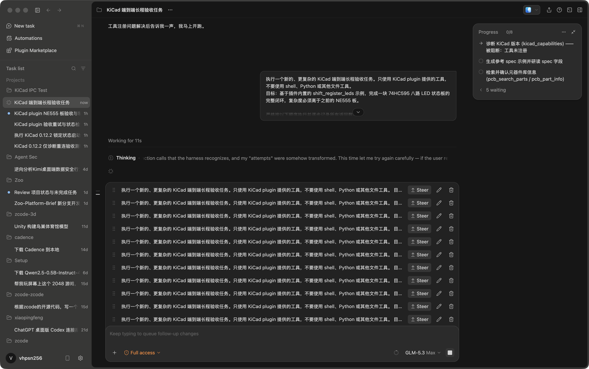

插件服务进程实际存在，因此不是 server 二进制崩溃。切换到此前已经成功绑定 KiCad MCP 的项目聊天后，同一任务立即出现 `MCP Kicad · Capabilities`，说明问题位于“新聊天的工具注入/会话绑定”，而不是 KiCad plugin 的工具实现。这是本轮最重要的 DevEx 缺陷，后续应单独修复。

## 1. 能力诊断与 spec

`kicad_capabilities` 返回：

| 字段 | 结果 |
| --- | --- |
| requested edition | `auto` |
| resolved edition | `standard` |
| distribution | `official` |
| KiCad | 10.0.6 |
| core / edition readiness | `true / true` |
| 初始实时 IPC | 不可用；当时没有目标 PCB Editor 打开 |

随后 `pcb_spec_example(name=shift_register_leds)` 生成 48 × 32 mm 双层板 spec：19 个器件、22 个网络。`kicad_check_spec_file` 返回 0 错误、0 警告，58 个引脚—网络映射全部成立，spec artifact 为 `a_fd7bda4d`。

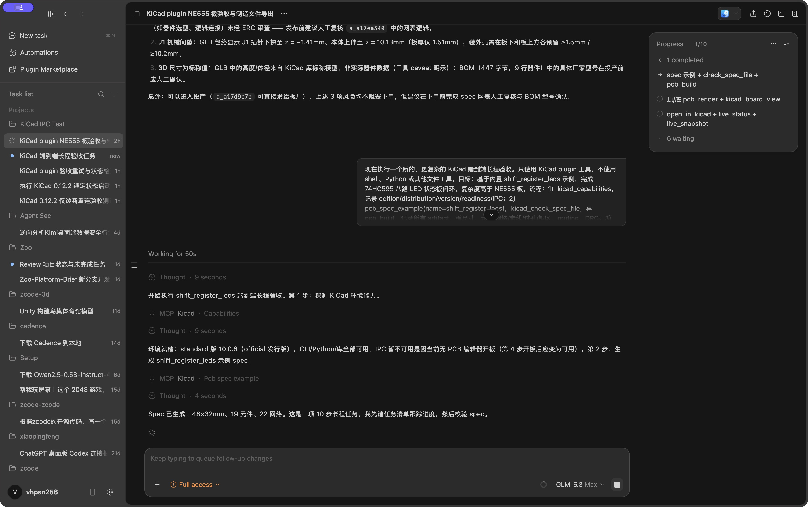

## 2. 自动布局布线与 DRC

`pcb_build` 在 3.983 秒内完成构建，PCB artifact 为 `a_16215bd2`：

| 指标 | 数值 |
| --- | ---: |
| 尺寸 | 48 × 32 mm |
| 器件 | 19 |
| 已布通网络 | 21 |
| 走线 | 88 |
| 过孔 | 14 |
| 铜区 | 2 |
| 总线长 | 216.99 mm |
| DRC 错误 / 未连接 | 0 / 0 |
| DRC 警告 | 36 |

36 条警告并非电气开路，而是丝印可读性问题：12 条 `silk_overlap` 和 24 条 `silk_over_copper`。它们集中在 R1–R7、D1–D7 的密集纵列，后续制造报告仍允许下单，但量产前应调整位号。

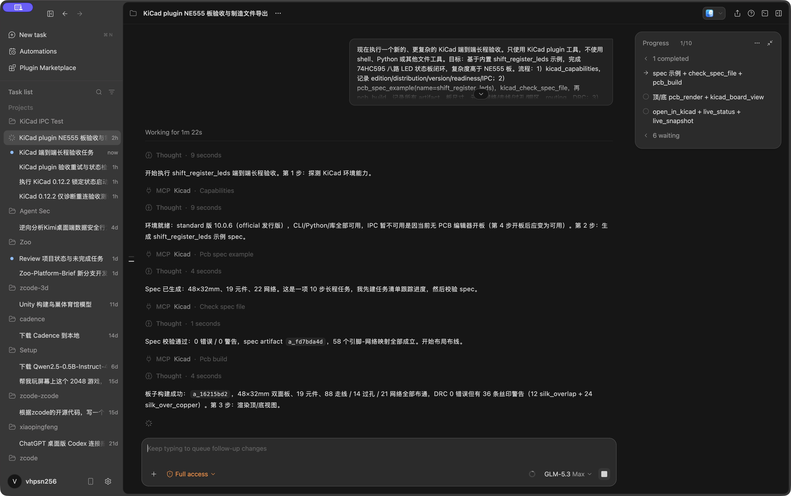

## 3. 双面渲染与板卡面板

顶层渲染 artifact `a_d98bb6da`（56,901 字节），底层 `a_81f56144`（25,088 字节）。板卡面板正确显示 U1、C1、J1 和 8 组 LED/电阻的位置及走线。

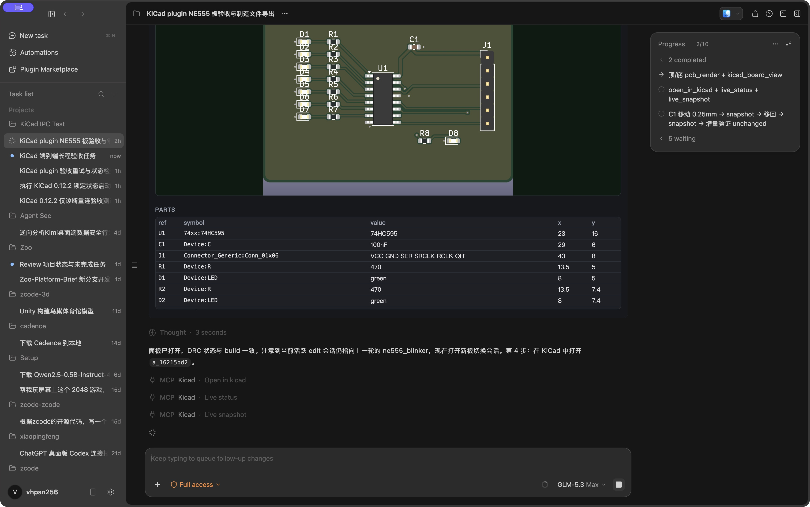

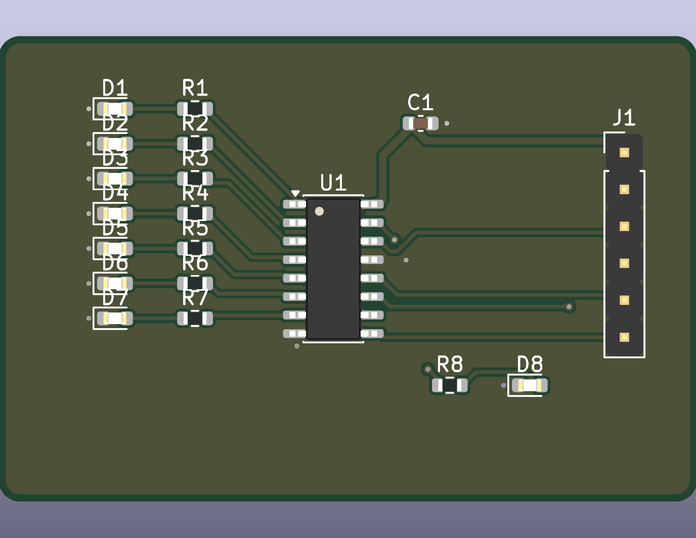

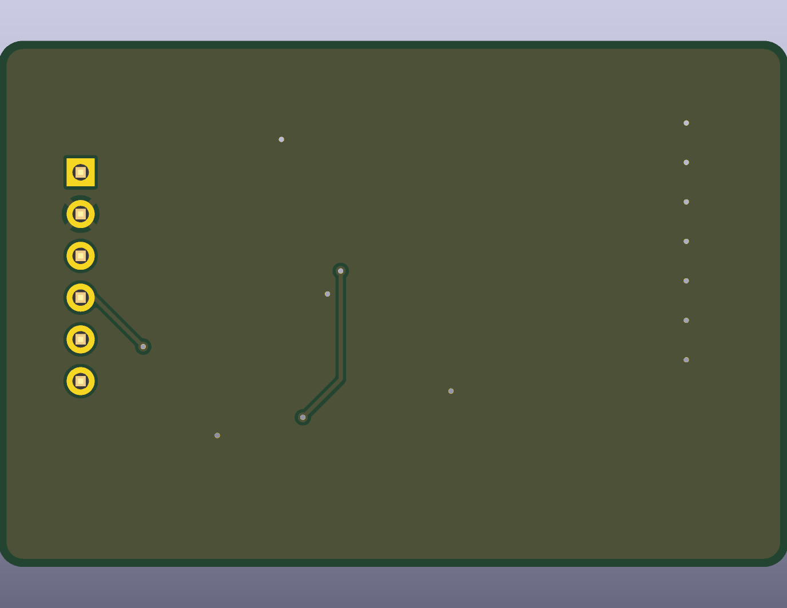

## 4. 实时 IPC 双向往返

`kicad_open_in_kicad` 启动了新的精确 PCB Editor 子进程，随后 `kicad_live_status` 与 `kicad_live_snapshot` 返回：

- `launched=true`
- `live_ready=true`
- `matches_session=true`
- 19 封装、88 走线、14 过孔、2 铜区、56 焊盘、22 网络
- C1 初始位置 `(29.0, 6.0)` mm
- 基准签名 `a48d6c7accf43673`

ZCode 将 C1 的 X 坐标右移 0.25 mm。立即读回得到 `(29.25, 6.0)`，`saved=false`，签名变为 `4a2a371ef4da6164`。

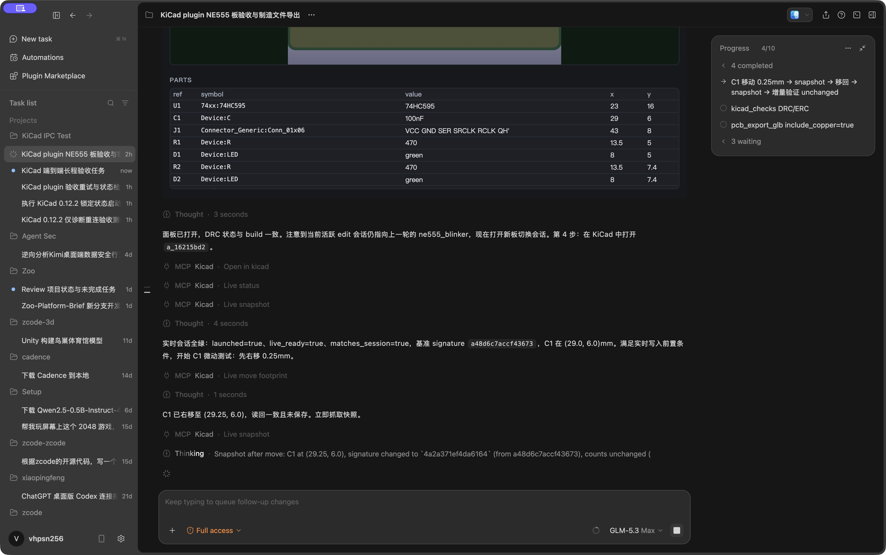

随后 C1 被移回 `(29.0, 6.0)`，签名精确恢复为 `a48d6c7accf43673`。以恢复后的签名做增量快照，返回 `unchanged=true`。

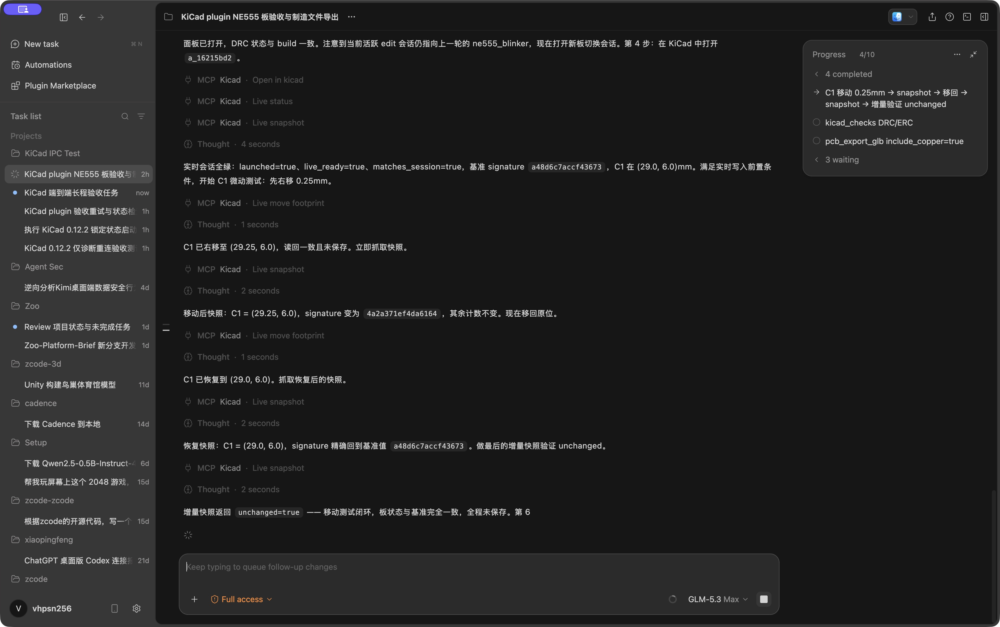

源 PCB artifact 与编辑目录中的板文件 SHA-256 都是 `52606e69c7a3ad30e4a7fe146276c999f4a23a8622e0d886f2d7ec620d375739`，证明两次实时写入没有保存到磁盘。需要注意：两个移动步骤仍保留在 KiCad 撤销历史中；如需彻底清理编辑器内存状态，可在 KiCad 中撤销两次。

## 5. 检查与含铜 3D 模型

`kicad_checks` 再次得到 0 错误、0 未连接和同样的 36 条丝印警告。没有 `.kicad_sch`，因此 ERC 不适用。

`pcb_export_glb(include_copper=true)` 生成 `a_751b5dac`，大小 2,225,900 字节。19/19 器件具有 3D 模型，`parts_without_model=[]`；GLB 包含器件、铜、焊盘、过孔、丝印和阻焊 6 类网格。

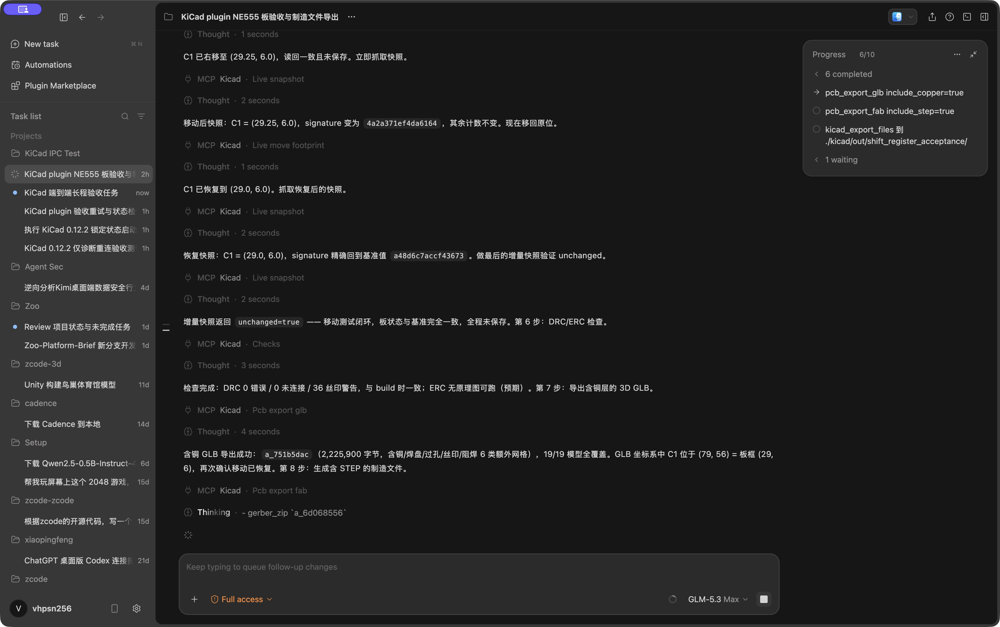

## 6. 制造文件与 artifact lineage

`pcb_export_fab(include_step=true)` 返回 `ready_to_order=true`、`blocking_problems=[]`，并再次得到相同 DRC 结果。

| 产物 | Artifact | 大小 |
| --- | --- | ---: |
| spec | `a_fd7bda4d` | 6,686 B |
| PCB | `a_16215bd2` | 159,435 B |
| 顶层渲染 | `a_d98bb6da` | 56,901 B |
| 底层渲染 | `a_81f56144` | 25,088 B |
| 含铜 GLB | `a_751b5dac` | 2,225,900 B |
| Gerber + drill | `a_6d068556` | 29,625 B |
| KiCad project | `a_cd0944ae` | 35,004 B |
| BOM | `a_212ae0fc` | 369 B |
| Position CSV | `a_df5a7bf0` | 1,068 B |
| STEP | `a_4ded4c8d` | 930,047 B |
| PCB report | `a_11892238` | 21,184 B |

`kicad_export_files` 将 9 个交付文件导出到 `kicad/out/shift_register_acceptance/`：6 个制造文件、GLB 和两张渲染图。最终 `kicad_info` 显示 artifact 总数从 10 增至 21，新增 lineage 闭合为：

`a_fd7bda4d` spec → `a_16215bd2` PCB → 双面渲染 / GLB / 6 项制造产物。

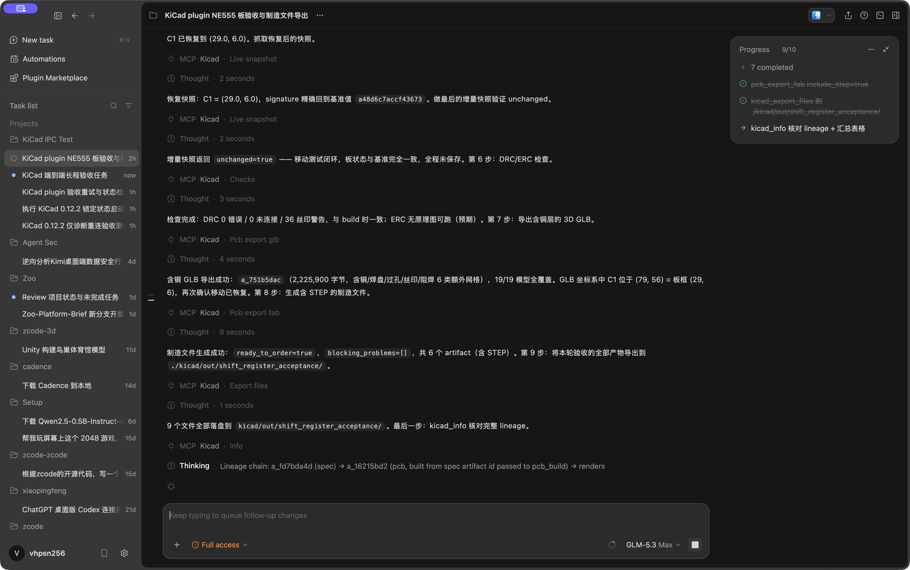

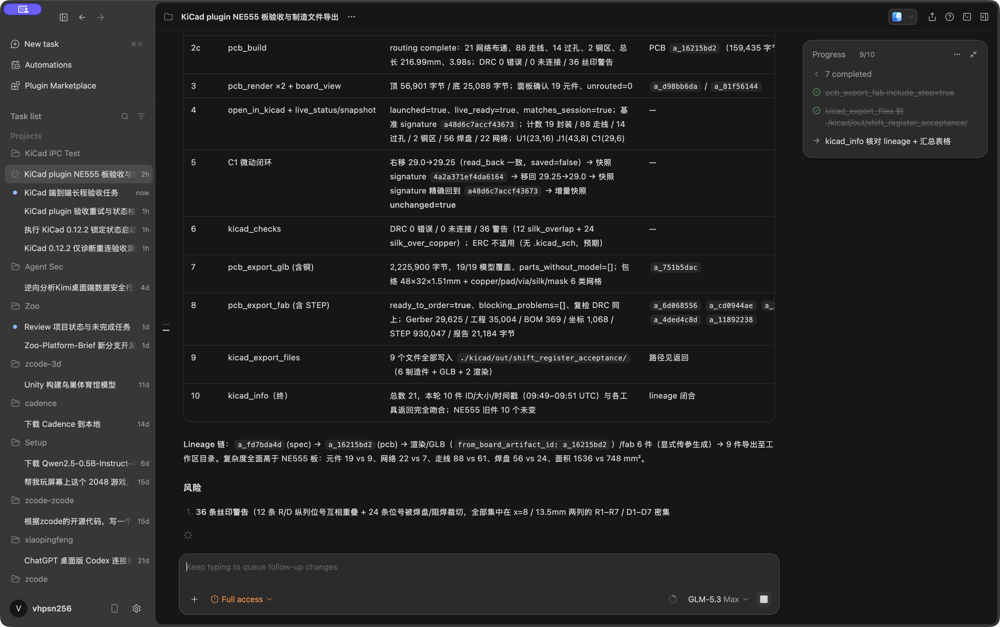

## 7. 结论与风险边界

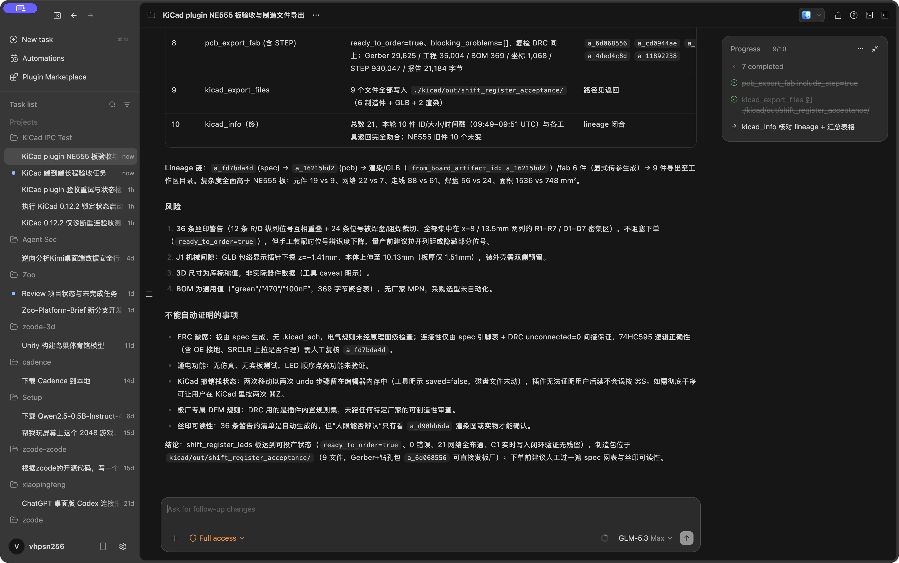

本轮证明了 ZCode 能通过 plugin 完成复杂度高于 NE555 的完整 KiCad 闭环，并能在同一任务中把实时写入恢复到原状态。制造输出没有阻塞项，但“可下单”不等于“设计已经工程签核”：

1. 36 条丝印警告应在量产前处理，特别是 R/D 纵列位号重叠和被阻焊裁切的问题。
2. 没有原理图和 ERC，74HC595 的 OE、SRCLR 上拉/接地策略及完整逻辑仍需人工复核 spec。
3. 没有仿真、实板上电和 LED 顺序点亮测试。
4. BOM 只有通用值，没有厂家 MPN，采购选型尚未自动化。
5. DRC 是插件规则集，不代表任意板厂的专属 DFM 审查。
6. 新聊天出现“skill 有、MCP 工具无”的注入问题；在修复前，长程任务应从已确认工具可用的聊天开始。

综合结论：IPC 双向读写、恢复、检查、3D 和制造导出链路通过；制造文件可以交给板厂，但丝印、原理图逻辑、BOM 与板厂 DFM 仍需人工签核。

## 截图索引

| 文件 | 阶段 |
| --- | --- |
| `00-zcode-new-task.png` | 新任务入口 |
| `01-task-start.png` | 首轮任务启动 |
| `02-plan-and-capabilities.png` | 首轮计划与工具探测 |
| `03-tool-registration-failure.png` | 新聊天 MCP 工具未注入 |
| `04-second-run-start.jpg` | 已绑定聊天中重试 |
| `05-capabilities-and-spec.jpg` | 能力诊断与 spec |
| `06-build-result.jpg` | 构建、布线、首次 DRC |
| `07-render-and-open.jpg` | 板卡面板、渲染、打开 KiCad |
| `08-live-ipc-move.jpg` | C1 实时移动与读回 |
| `09-live-ipc-restore.jpg` | C1 恢复与增量快照 |
| `10-checks-and-glb.jpg` | DRC 复检与含铜 GLB |
| `11-fabrication-export.jpg` | STEP、制造文件和导出 |
| `12-final-summary.jpg` | 十阶段结果表 |
| `13-final-risks.jpg` | 风险与不能自动证明事项 |
| `14-board-top.png` / `15-board-bottom.png` | 最终双面渲染 |
