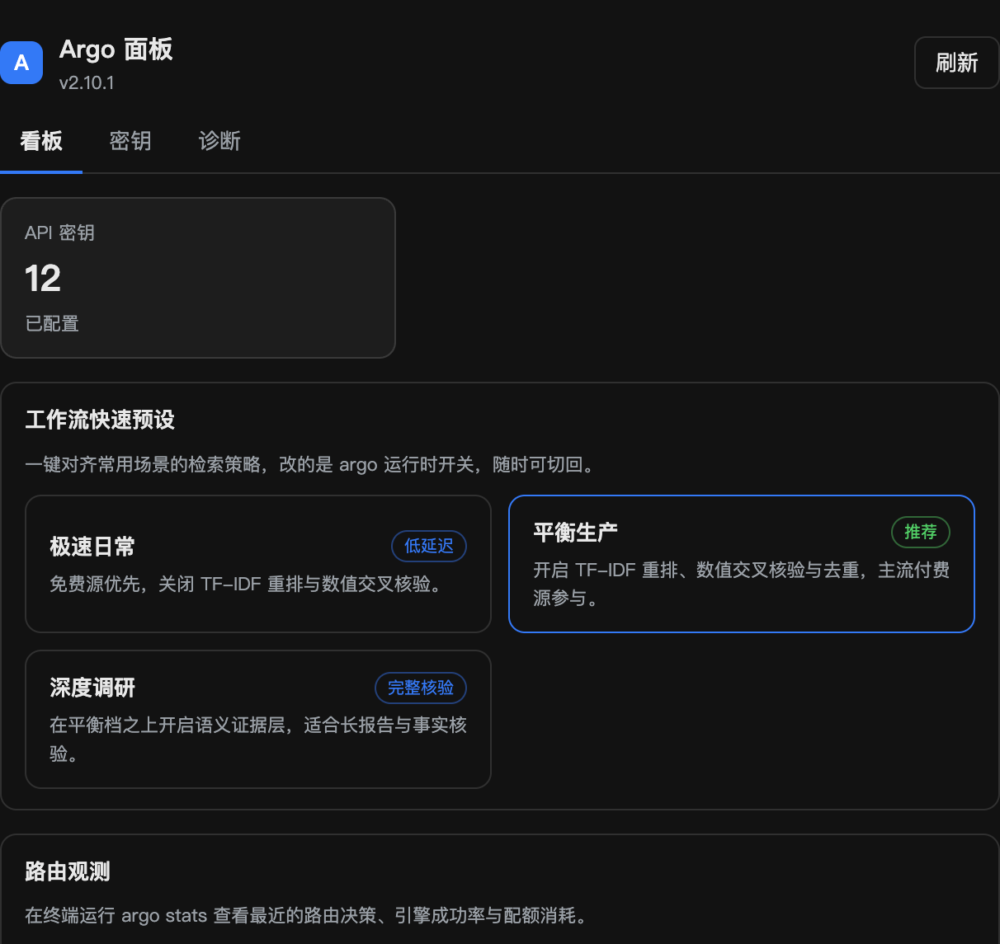
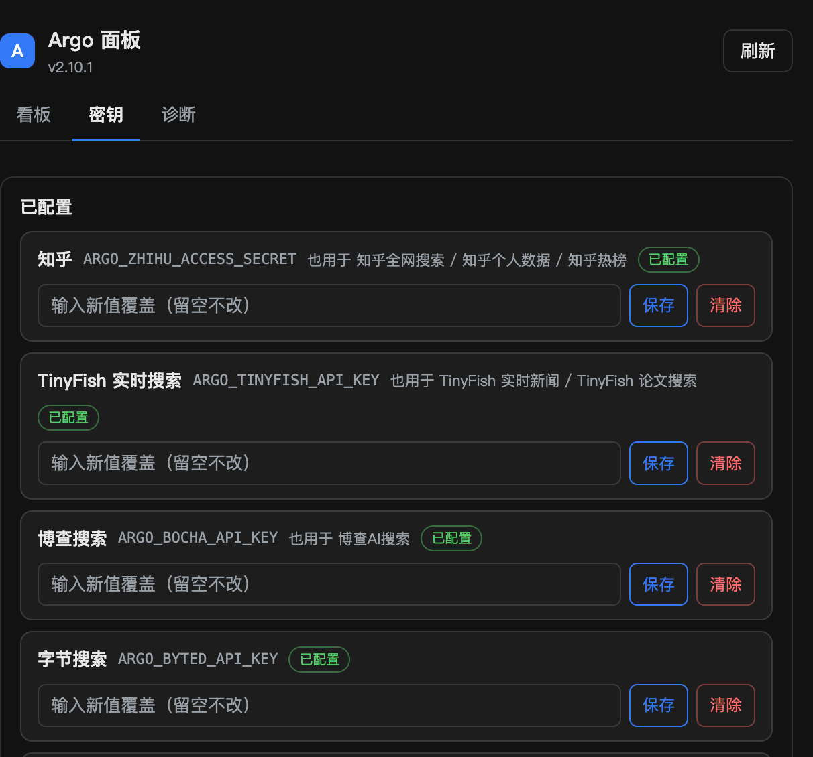

# Argo 阿尔戈 for ZCode

统一搜索、网页抓取与证据核验插件：284 个源、240 个免密钥可用，覆盖深度研究、学术、舆情、公众号、招聘聚合与本地检索。不止搜到，还要核到——高后果问题强制核验正文并回填证据分。

能力由 [argo CLI](https://github.com/taxueseek/argo) 提供，本插件是它在 ZCode 中的三层接入：

| 层 | 形态 | 说明 |
|---|---|---|
| 模型通道 | skills + commands + agents | `/argo` 日常一问、`/wide-research` 多轨编排取证；`argo-researcher` worker 用工具白名单机制化约束 |
| 控制通道 | ui.surfaces 面板 | 「Argo 面板」三页：看板（预设与密钥计数）、密钥（按引擎归属分组、值不回显）、诊断（版本/路径/预算自检）；配置经页面直连服务，不占模型 token |
| 取证通道 | skill+CLI（主）/ MCP（可选） | 模型按 skill 纪律调 `argo search/fetch/research` 等 CLI 命令；面板 MCP 工具标成 app-only，不出现于模型工具列表，零常驻 token |

## 面板

看板页：密钥总量、三档工作流预设（极速日常 / 平衡生产 / 深度调研）。预设改的是 argo 运行时开关，写进 argo env 文件，随时可切回。

密钥页：按引擎归属分组列出 argo 认得的每个 env key，只显示 key 名与用途，值永不回显；保存与清除直接改 argo 的 env 文件（chmod 600）。某 key 名下的引擎全部停用时，该 key 归入「已停用」。

诊断页：argo 版本与解释器、配置基线与本机覆盖层、env 文件权限、daemon 状态、预算记录与 `paths --check` 自检输出。

引擎级的启用/停用由面板服务的 `set_engine` 工具承担，写入 argo 本机覆盖层 `config.local.yaml`（gitignore，不随 argo 发版）；界面上按「已停用」分组呈现状态。

`ui/panel.html` 保持可读源码，`ui/vendor/ext-apps.mjs` 是官方 `@modelcontextprotocol/ext-apps@2.0.0` 浏览器包。宿主 `resources/read` 只回文本、页面里的相对 import 解析不了，所以服务端读取时把 vendor 内联进同一段脚本再返回，无需构建步骤。

## 前置依赖

- [argo CLI](https://github.com/taxueseek/argo)（插件能力全部经由它；未装时 skill 会给出安装指引）
- ZCode Desktop（面板需要支持 Plugin UI 的版本；Node.js 由宿主提供）
- 面板配置桥依赖 pyyaml（argo 唯一必需第三方依赖，装 argo 时已安装）

## 安装后验收

1. **模型通道**：新会话发送 `/wide-research 多轨研究一个争议问题`，观察是否按轨道拆分、派发 `argo-researcher` worker、产出带来源账本与质量门的报告（`passed=false` 时应降级表述）
2. **控制通道**：打开侧栏「Argo 面板」，切换一个预设后 argo env 文件里的运行时开关应随之变化；密钥页保存一个测试 key 后 `argo search --list-engines --detail --engine <名>` 应显示已配置
3. **零 token 校验**：会话内模型工具列表不应出现 `mcp__argo-panel__*` 工具（面板工具仅页面可调）

## 隐私与安全

- 密钥写入 argo env 文件（chmod 600），面板只回显 key 名不回显值
- 引擎开关写入 argo 本机覆盖层 `config.local.yaml`（gitignore，不随 argo 发版）
- 使用日志留在本机（`ARGO_USAGE_LOG=0` 可整体关闭）
