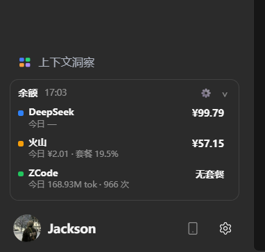
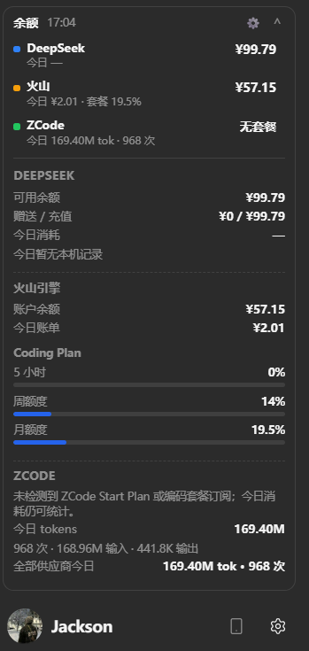
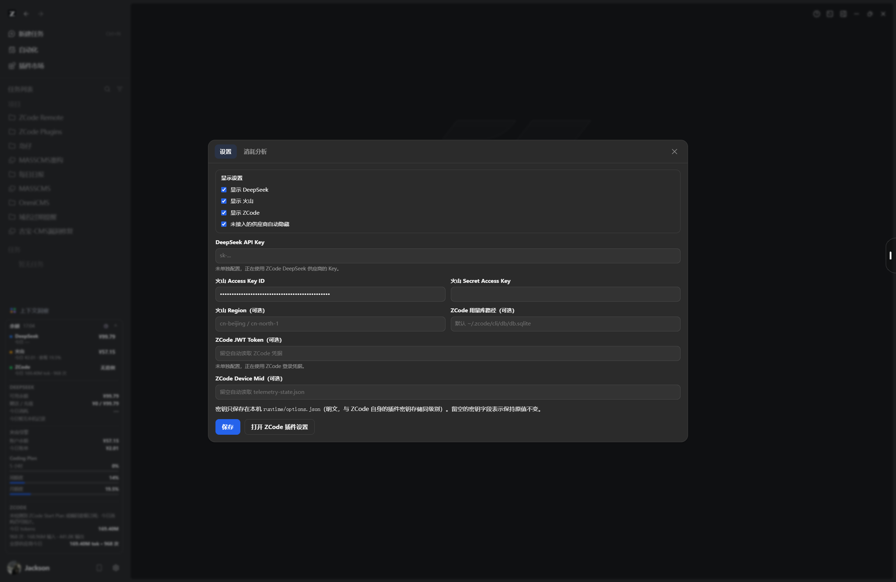
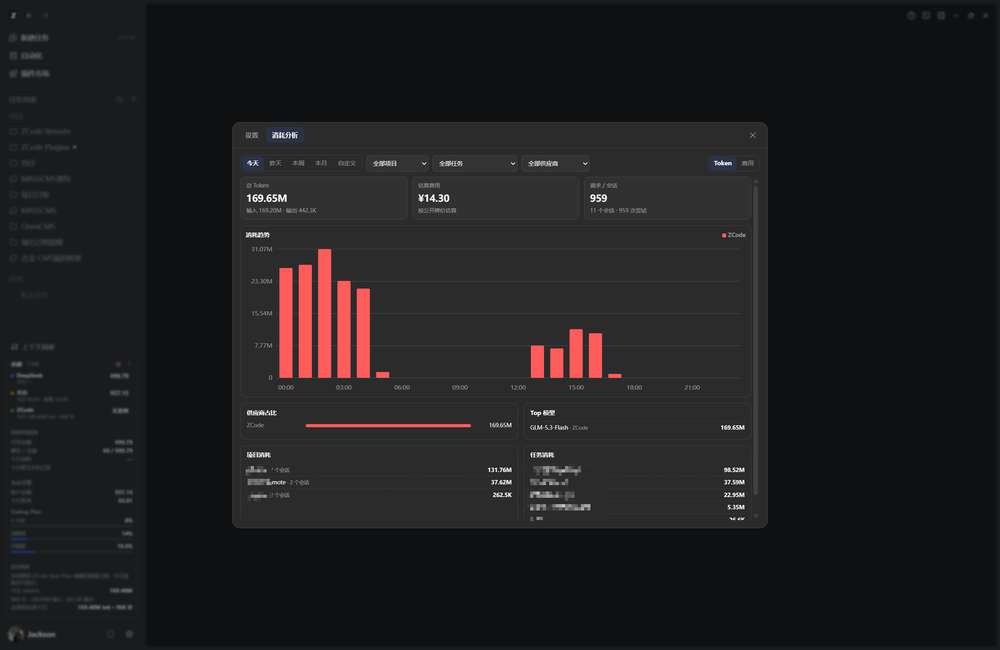
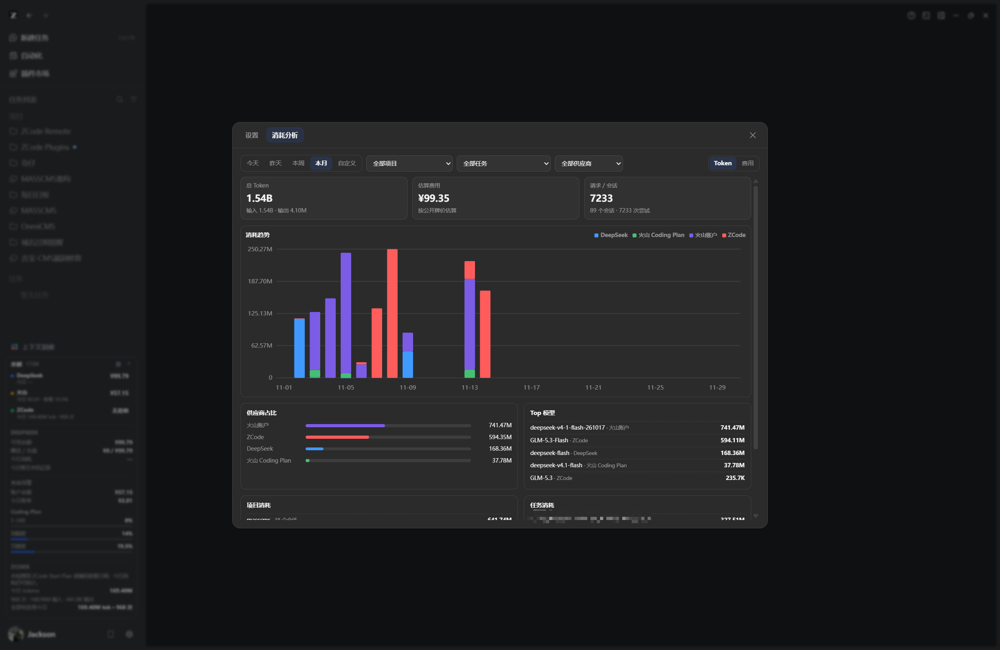
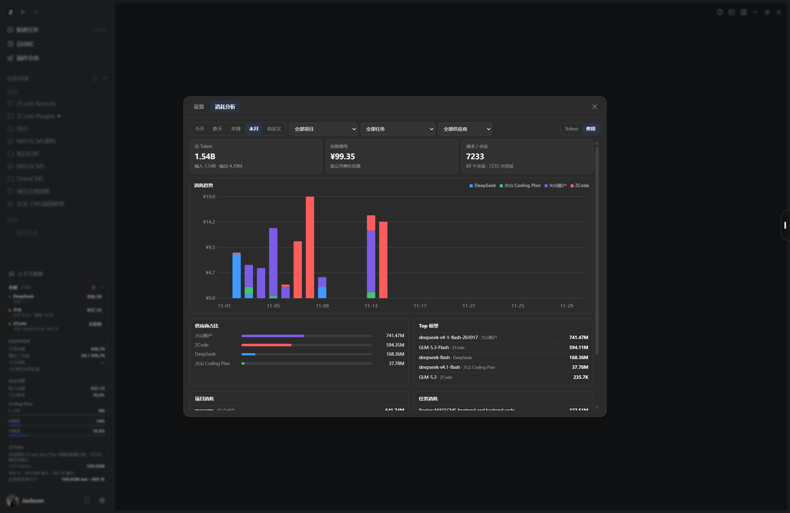

# Balance Dashboard · 余额面板

[](../../releases) [](LICENSE) [](https://zcode.z.ai)

> **关键词 / Keywords**: ZCode 插件, ZCode plugin, ZCode Desktop, 余额查询, 用量统计, token 消耗, DeepSeek 余额, 火山引擎余额, 火山方舟 Coding Plan, BigModel, GLM, consumption analytics, usage dashboard, sidebar widget, Electron

在 ZCode 左侧边栏常驻一个紧凑的余额组件：

- 每行显示 **余额/套餐** 与 **今日消耗（费用 + token）**；
- 点击任意余额行打开 **消耗分析** 弹框：今天 / 昨天 / 本周 / 本月 / 自定义日期，支持项目、任务、供应商过滤，展示堆叠柱状图、供应商占比、Top 模型和项目/任务排行；
- 点击齿轮打开同一个弹框的 **设置** 标签，可直接填写密钥，保存后立即刷新。

支持的数据：

- **DeepSeek**：账户余额（总额 / 赠送 / 充值）与今日消耗。
- **火山引擎**：账户可用余额、当日账单消耗，以及 Coding Plan 的额度窗口（日 / 5 小时 / 周 / 月）。
- **ZCode**：Start Plan 或编码套餐的额度占用，以及本机今日请求数与 token 消耗。

> English: a ZCode Desktop sidebar widget that shows DeepSeek / Volcengine (Ark & Coding Plan) / ZCode plan balances and today's token usage. Clicking any row opens a consumption analytics modal (time ranges, project/task/provider filters, stacked charts); the gear opens a settings modal for API keys.

## 截图

**侧边栏组件**（左：折叠状态；右：展开状态）

| 折叠状态 | 展开状态 |
| --- | --- |
|  |  |

**设置弹框**（显示开关 + API 密钥配置）



**消耗分析弹框**

| 今日 · Token 视图 | 本月 · Token 视图 |
| --- | --- |
|  |  |
| **本月 · 费用视图** | |
|  | |

## 副作用披露（必读）

为透明起见，本插件的所有副作用如下：

- **Hook（SessionStart）**：安装/更新后自动运行，同步运行时文件到 `~/.zcode/balance-dashboard/runtime/`，并检查 `resources/app.asar`；
- **修改 `app.asar`**：ZCode 插件系统没有左侧边栏挂载点，本插件会在 `out/main/index.js` 末尾追加一行本插件专属的动态 import（带完整 SHA-256 全量校验、自动备份 `app.asar.balance-dashboard.bak` 与失败回滚；`/remove-sidebar-widget` 可还原）；
- **本地文件写入**：`~/.zcode/balance-dashboard/runtime/`（状态、运行时副本、`options.json` 明文配置）；
- **网络请求**（仅官方域名）：`api.deepseek.com`（余额）、`billing.volces.com` 签名接口（火山余额/账单/额度）、`zcode.z.ai` 与 `api.z.ai` / `bigmodel.cn`（套餐额度）；不发送任何遥测；
- **凭据处理**：API Key 存储在 ZCode 插件配置或本机 `options.json`（明文，与 ZCode 自身密钥存储同级），仅本机读取，不写日志、不上传；
- **命令执行**：Hook 与主进程注入器会以子进程方式调用 `node` 执行本插件自带脚本（采集用量、查询分析、asar 校验/重打包）；
- **MCP server**：无。

## 前置条件

- 本机可用的 Node.js 运行时（`node` 命令）。
- 左侧组件需要写入 ZCode 的 `app.asar`；安装或更新后必须**完全退出并重开 ZCode**。
- 如果 ZCode 安装在 `Program Files` 且当前用户没有写权限，注入会提示“需要管理员权限”；以管理员身份运行一次 ZCode，或手动执行注入脚本。
- 如果 ZCode 安装在非默认目录，可设置 `ZCODE_ASAR` 环境变量指向实际的 `resources/app.asar`。

## 安装

仓库自带 `marketplace.json`，可以把本目录作为 ZCode 插件市场直接添加。

**方式一：添加 GitHub 市场（推荐）**

1. 把本仓库推送到 GitHub 后，复制仓库地址（如 `https://github.com/<user>/balance-dashboard`）。
2. 在 ZCode 中打开 **插件市场 → 添加 → 添加插件市场**，粘贴仓库地址。
3. 在对应市场里安装 `balance-dashboard`。

也可以直接在 [Releases](../../releases) 下载 `balance-dashboard-x.y.z.zip`，解压后把解压目录作为插件市场路径添加（zip 内自带 `marketplace.json`）。

**方式二：本地目录**

1. `git clone` 本仓库到任意目录。
2. 在 ZCode 中打开 **插件市场 → 添加 → 添加插件市场**，粘贴克隆出的目录路径（即包含 `marketplace.json` 的目录）。
3. 在 **个人市场** 中安装 `balance-dashboard`。

安装完成后会触发 SessionStart 钩子：

1. 复制运行时文件到 `~/.zcode/balance-dashboard/runtime/`；
2. 检查并修改 `app.asar`；
3. 如果 ZCode 正在运行导致文件被锁定，会排定一个收尾进程，等你完全退出 ZCode 后自动替换；
4. **完全退出并重开 ZCode**（含托盘/后台进程），左侧边栏底部、头像行上方会出现余额组件。

## 配置

三种方式任选其一，优先级从低到高：

1. ZCode **设置 → 插件 → balance-dashboard** 的 `userConfig`；
2. `~/.zcode/cli/plugin-secrets.json` 中保存的敏感值；
3. 组件齿轮弹框保存的 `~/.zcode/balance-dashboard/runtime/options.json`（最高优先级）。

也可以在进程环境变量中提供。弹框中已配置的密钥不会回显，留空表示保持原值。

| 选项 | 环境变量 | 说明 |
| --- | --- | --- |
| `deepseek_api_key` | `DEEPSEEK_API_KEY` | DeepSeek 平台 API Key。留空时自动读取 ZCode 的 DeepSeek 供应商配置。 |
| `volc_access_key_id` | `VOLCENGINE_ACCESS_KEY_ID` | 火山引擎 Access Key ID。 |
| `volc_secret_access_key` | `VOLCENGINE_SECRET_ACCESS_KEY` | 火山引擎 Secret Access Key。 |
| `volc_region` | `VOLC_REGION` | 可选。Coding Plan 默认 `cn-beijing`，账单默认 `cn-north-1`。 |
| `zcode_usage_db` | `ZCODE_USAGE_DB` | 可选。默认 `~/.zcode/cli/db/db.sqlite`。 |
| `zcode_jwt_token` | `ZCODE_JWT_TOKEN` | 可选。默认从 `~/.zcode/v2/credentials.json` 解密。 |
| `zcode_device_mid` | `ZCODE_DEVICE_MID` | 可选。默认读取 `telemetry-state.json`。 |

火山引擎的账户余额与 Coding Plan 额度接口需要 **AK/SK 签名**。仅有 Ark API Key 时，可以显示本地统计的今日消耗，但无法读取官方余额与额度。

`runtime/options.json` 为明文存储（与当前 ZCode `plugin-secrets.json` 同级别），仅保存在本机用户目录。

### 显示设置

设置弹框顶部的“显示设置”可以控制侧边栏显示哪些行，保存在 `runtime/options.json`：

| 选项 | 默认 | 说明 |
| --- | --- | --- |
| `show_deepseek` | `1` | 是否显示 DeepSeek 行 |
| `show_volcano` | `1` | 是否显示火山行 |
| `show_zcode` | `1` | 是否显示 ZCode 行 |
| `hide_unconfigured` | `1` | 未配置 Key/AK 的供应商自动隐藏 |

某行最终显示 = 对应开关开启 **且**（`hide_unconfigured` 关闭 **或** 该供应商已接入）。所有行都隐藏时，卡片只保留头部和齿轮，仍可打开设置恢复。

## 消耗分析

点击余额行后，主进程按需调用 `scripts/query-analytics.mjs` 查询本地用量库：

- 时间：今天/昨天按小时分桶，本周/本月/自定义按天分桶，超过 62 天按周聚合；
- 项目：按 `session.project_id + session.directory` 聚合；
- 任务：`session_task_link` 当前为空，因此以主会话（`session.id + title`）作为任务；
- 供应商：DeepSeek / 火山 Coding Plan / 火山账户 / ZCode / 其他；
- Token 口径：`computed_total_tokens` 优先，否则 `input + output`，不重复累加 cache/reasoning；
- 费用按公开牌价估算，界面标注「估算」。

所有图表都是内联 SVG，不依赖外部图表库；颜色使用 ZCode 主题的 `--color-usage-chart-*` 变量。

## 左侧组件注入说明

ZCode 的插件系统目前没有左侧边栏挂载点，因此左侧组件通过和 token 用量悬浮条相同的方式实现：

- 在 `app.asar` 主入口 `out/main/index.js` 尾部追加一行动态 import；
- 主进程 loader 只向 ZCode 本地页面注入 renderer 脚本；
- 组件挂在 `aside[data-testid="sidebar"]` 的 `footer`（头像行）之前，并在 React 重渲染后自动纠正顺序；
- 每 60 秒调用一次一次性 Node 采集器，把数据推送到 renderer；弹框请求通过 `window.__balanceDashboardRequests` 队列交给主进程处理；
- 侧边栏折叠、DOM 结构变化时自动隐藏/重挂，失败时不会破坏 ZCode。

注入标记只属于本插件；升级或重新安装时会只剥离本插件自己的行，**保留 token 用量悬浮条等其他插件的注入**。如果检测到 token 用量悬浮条的 `app.asar.zusage.tmp` 待替换包，本插件会先让行，并启动一个后台跟进进程：等悬浮条完成替换后自动把余额组件写入新的 `app.asar`，通常仍然只需要一次“完全退出并重开”。

> 注入在 ZCode 运行时无法直接覆盖 `app.asar`，所以第一次安装后一般需要**完全退出并重开一次**；如果状态显示“待重启生效”，再退出重开一次即可。

状态写入 `~/.zcode/balance-dashboard/runtime/status.json`。

## 数据口径

- **DeepSeek 余额**：`GET https://api.deepseek.com/user/balance`。
- **DeepSeek 今日消耗**：DeepSeek 官方 API 不提供用量查询，因此按 ZCode 本机用量库中归属于 DeepSeek 供应商的请求估算金额，界面中标注「估算」。
- **火山引擎账户余额**：`QueryBalanceAcct`（billing，2022-01-01）。
- **火山引擎账户今日消耗**：`ListBillDetail`（billing，`ExpenseDate`=今天）。当日账单可能尚未生成，此时回退为本地估算。
- **火山引擎 Coding Plan**：优先 `GetAFPUsage`（Agent Plan），否则 `GetCodingPlanUsage`（Coding Plan），均通过 Ark 签名接口查询。
- **ZCode 套餐余额**：Start Plan 读取 `zcode-plan/billing/balance`；编码套餐读取 BigModel / Z.ai 的 `monitor/usage/quota/limit`。
- **ZCode 今日消耗**：读取本机 `model_usage` 表，按本地时区当天聚合请求数、输入 / 输出 / 思考 token。侧边栏 ZCode 行只统计 ZCode 供应商桶，与「消耗分析」中的 ZCode 一致；全部供应商的今日总量在展开详情的「全部供应商今日」中显示。

凭据只保存在 ZCode 的插件配置、本机 `options.json` 或进程环境变量里，不会被写入日志或缓存文件。网络请求只发往对应的官方域名。

## 移除左侧组件

运行：

```bash
node "${ZCODE_PLUGIN_ROOT}/scripts/unpatch.mjs"
```

或在会话中执行 `/remove-sidebar-widget`。它只移除本插件的注入行，保留其他插件的注入。替换成功后重开 ZCode 生效。

## 事故与修复（0.2.1）

0.2.0 的 asar 重打包脚本有一个严重 bug：它先把每个文件的 `offset` 改成了新位置，然后又用这个新 offset 去原 asar 里读取数据，导致替换点之后的 4000+ 个文件整体错位，ZCode 启动时完整性校验失败。

0.2.1 已修复：

- 重打包前先保存不可变的原始 offset，拷贝数据只使用原始 offset；
- 重打包后对**全部 3 万多个条目**逐文件重算 SHA-256 和 block hashes，并与 header 中的 integrity 比对；
- 只有全量校验通过才会替换 `app.asar`；
- 替换前创建 `app.asar.balance-dashboard.bak`（优先 NTFS hardlink），替换后再校验一次，失败自动用备份回滚；
- `finalize` / `post-patch` / `session-start` 的每条替换路径都会先校验 stage，禁止直接提升未校验的补丁。

如果 0.2.0 的事故留下损坏的 `app.asar`，请先完全退出 ZCode，再运行：

```bash
node "<插件目录>/scripts/restore-backup.mjs"
```

如果没有备份，使用 ZCode 官方安装包恢复 `resources/app.asar`。不要使用 `app.asar.broken-*` 文件。

## 已知限制

- 这是非官方注入能力。ZCode 官方更新会重写 `app.asar`，SessionStart 钩子会尝试自动修复；如果左侧边栏 DOM 结构变化，组件会 fail-closed（不显示，不影响应用），需要按新结构更新选择器。
- 安装/注入后需要重启；如果 `app.asar` 被占用，需要等收尾进程完成或手动在 ZCode 完全退出后重跑一次注入。
- DeepSeek 今日消耗和火山 Coding Plan 的今日消耗都是本机统计，不是服务商账单。
