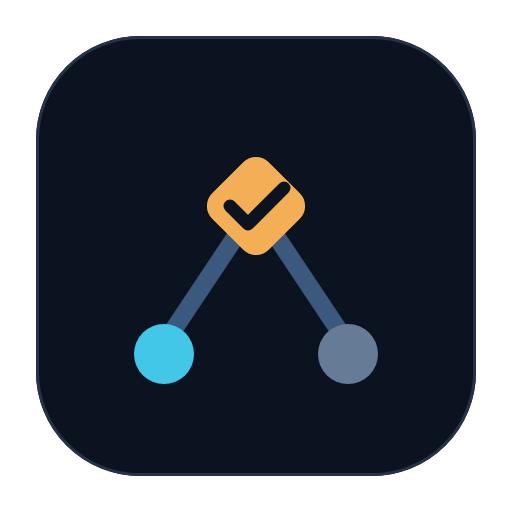

<p align="center"></p>

<h1 align="center">Baton</h1>

<p align="center"><a href="#regression"></a>
<a href="#"></a>
<a href="LICENSE"></a>
<a href="https://github.com/Lumos-789/baton"></a></p>

> The sole ticket / DAG / session-subagent control plane over OpenSpec changes.
> A local CLI exposes deterministic session actions; the main session
> delegates each assignment with the DSH `subagent` tool, binds the child id,
> and reconciles the completion notice against a sealed receipt.

**[Discussions](https://github.com/Lumos-789/baton/discussions)**

## The problem it solves

OpenSpec is strong on spec-driven decomposition (proposal -> tasks -> archive)
but does not execute. Baton turns an approved change into finished work,
deterministically: the main session never decides ticket state itself. It
forwards the deterministic `actions` returned by the Baton CLI to DSH
subagents verbatim, then reconciles each completion notice against a **sealed
receipt** (the assignment's verification commands run green in an isolated
worktree). Free-text subagent output is ignored.

A sealed receipt is hash-bound evidence produced locally by `receipt.py`
(task-packet hash + clean, advanced HEAD + exit-0 verification results). The
whole receipt body is covered by a canonical `sha256` digest (`receiptHash`),
so an edited `exitCode`, `changed_files`, `commit_sha` or a lease claim from
another ticket is rejected before any merge. It is integrity evidence, not a
cryptographic proof against a hostile subagent (the digest has no secret).

The change's tasks and the execution share the same granularity (one
assignment ~ one task), and three seams are bridged deterministically:

| Seam | Baton's answer |
|---|---|
| Dependency (section-order DAG -> what to run next) | `SessionController.actions()` computes the frontier fresh every call and atomically claims distinct tasks |
| Concurrency (<=5 parallel tasks) | one isolated git worktree per assignment; integration serialized by a repository-scoped lock |
| State (subagent done -> task resolved) | a sealed receipt is the only success evidence; the controller integrates the branch, finalizes the attempt, and flips the task's `[x]` in tasks.md |

**Baton is the conductor. `SessionController` is the sole deterministic
scheduler; the main session is a mechanical forwarder; OpenSpec is the plan
face.**

## Install (DSH)

Baton is a DSH bundle: one package mounts the `baton` skill. Execution goes
through the bundled Python CLI (`scripts/session_control.py`). It requires DSH
`0.2.1-rc.2` or newer, a profile that provides the `subagent` tool (the shipped
`dsh-base` does), and Python 3.10+ on `PATH`.

```bash
# From a checkout
dsh plugin add /path/to/baton

# Once published
dsh plugin add dsh-openspec-baton
```

Verify the bundle (self-contained, needs only `python3` + `git`; drives the
real CLI against a temp git repo and exits 0 when healthy):

```bash
python3 tests/cli_smoke.py
# CLI SMOKE PASS: actions dispatch, status snapshot, error exit - all green
```

The package name is `dsh-openspec-baton` to avoid colliding with the unrelated
`dsh-baton` plugin. The repository and brand remain `baton`.

## Install (ZCode)

The same repository also carries a ZCode plugin form
(`.zcode-plugin/plugin.json`): it mounts the identical
`skills/baton/SKILL.md`; the skill drives the same
`python3 scripts/session_control.py` CLI. Python 3.10+ must be reachable as
`python3`.

## Quick start

```bash
# In your business project, write an OpenSpec change (the project's normal
# openspec/AGENTS.md workflow) and get it approved:
#   openspec/changes/<change-id>/proposal.md + tasks.md   (unchecked N.M tasks)
```

`tasks.md` is the ticket source. Sections are phases, tasks carry `N.M` ids,
and a task is blocked by every task in earlier sections (tasks within one
section run in parallel). Minimal shape:

```markdown
# Tasks: add-login

## 1. Backend

- [x] 1.1 token endpoint
- [ ] 1.2 session persistence

## 2. Frontend

- [ ] 2.1 login form
```

`[x]` = resolved, `[ ]` = ready (no draft state); the exact parsing rules are
in [docs/ticket-format.md](docs/ticket-format.md).

Then ask the session:

```
run baton on <project_path> <change-id>
```

The skill drives `actions` -> `subagent` -> `bind` -> completion notice
-> `reconcile` until the batch returns `complete`.

## Architecture

```
main session (mechanical forwarder - no model-driven state decisions)
  |- session_control.py <project> <change> actions --session-id ... --capacity<=5
  |     -> SessionController.actions(): recover/reconcile sealed receipts,
  |        compute frontier, atomically claim, prepare isolated worktrees +
  |        immutable Task Packets, return dispatch/recover/resolve_merge/
  |        wait/blocked/complete actions
  |- subagent(dispatch.prompt, cwd=dispatch.cwd) -> child id
  |- session_control.py <project> <change> bind <assignment_id> <claim_token> <agent_id>
  |- runtime sends the subagent completion notice
  |- session_control.py <project> <change> reconcile ... --agent-terminal ...
        -> sealed receipt -> succeeded + integrated; otherwise unknown + recover

SessionController (the sole deterministic scheduler)
  |- durable plan store (.dsh/baton/queue.db): revisions, attempts, leases,
  |  sealed receipts, completion facts
  |- isolated assignment worktrees + a shared integration worktree
  |- serial git integration; merge conflicts preserved (never auto-aborted)
  `- latest-plan completion (all required tickets verified + integrated)
```

## Capabilities

**Session-subagent execution** (sole path):
- **Deterministic scheduling** - claim, lease, worktree, receipt verification,
  integration, completion are all scripted; the model never decides state.
- **Isolated worktrees** - one branch per assignment; capacity <= 5 sliding
  window; integration serialized by a repository-scoped lock.
- **Sealed receipts** - `scripts/receipt.py verify` / `seal` is the only
  accepted success evidence; a completion notice without a receipt flips the
  attempt to `unknown`.
- **Fixed 7200 s leases** - a claim's lease is hardcoded to 7200 s (2 h): there
  is no CLI flag and no renewal entry point. A lease that runs out is judged
  `lease-expired` (the attempt flips to `unknown` with that `failure_code`) and
  the ticket is re-dispatched by the next `actions` call.
- **Operator escape hatches, both guarded** - `abandon <assignment_id>` retires
  a stuck attempt: it releases the lease and drops the attempt's eligibility
  for reconcile, while its worktree, branch, commits, packet and receipt stay
  on disk for audit. Abandoning an attempt that is plausibly still working
  (active, no failure evidence, no receipt, less than 80% of its lease spent)
  is refused with the judgment data unless `--force` - so a session taking
  over a run cannot silently destroy live work. `adopt <assignment_id>` is the
  reverse hatch: an abandoned attempt whose sealed receipt arrived late is
  re-verified and integrated instead of thrown away (a newer sealed successor
  refuses the adopt and lists both evidence sets for a human choice).
- **Relay-safe judgments** - `status` shows per attempt a `relay` block:
  `elapsedSec` / `leaseRemainingSec` / `leaseElapsedFraction`,
  `receiptExists`, worktree liveness signals and a `suggestedAction`
  (`wait` / `reconcile` / `adopt` / ...). The dispatch prompt tells subagents
  to refresh a `progress` heartbeat in the run directory (outside the
  worktree, so it never dirties a seal), and `status` reports its age -
  "alive" is read from data, not guessed.

**Control plane**:
- **OpenSpec-native cognitive phase** - "use baton to finish X" means the
  session runs the project's OpenSpec workflow (align -> write the change ->
  user approves), then drives execution to `complete`. No self-built
  Grill/Brief/approval state machine.
- **Live plan = edit tasks.md** - add tasks or sections at runtime; the next
  `actions()` call records a new plan revision and the frontier is recomputed.
  In-flight packets stay immutable.
- **Verification is change-wide and persisted** - `--verify "<cmd>"` (top-level,
  repeatable) is persisted with the run on the first claim, so later packets -
  including ones prepared by `reconcile` - reuse it; passing it again is an
  explicit override. There is no per-task verification override.

**Observability**: `scripts/ticket_board.py` produces a pure static HTML
Kanban board over a project's OpenSpec changes (zero process, zero port,
colored feature tags, open via `file://`):

```bash
python3 scripts/ticket_board.py build-all /path/to/project
# → .dsh/baton/board-all.html   (every change on one board)
python3 scripts/ticket_board.py build /path/to/project <change-id>
# → .dsh/baton/<change-id>/board.html
# <change-id> is optional for build/scan when the project has exactly one
# change — the common day-one case — and the omission fails loud (naming the
# dir or the candidates) on zero or several.
```

Clicking a card shows the copy-paste `check` / `uncheck` commands (runnable
from any directory); a flip rewrites any built board in place — just reload
the page.

## Bundle contents

| Path | Purpose |
|---|---|
| `index.js` | mounts the bundled `skills/` provider |
| `cordis.patch.yml` | DSH bundle insert row (`dsh-openspec-baton`) |
| `.zcode-plugin/plugin.json` | ZCode plugin manifest (same skill) |
| `skills/baton/SKILL.md` | the `baton` skill (actions -> subagent -> reconcile) |
| `scripts/session_control.py` | the control-plane CLI (`actions`/`bind`/`reconcile`/`status`/`cleanup`/`abandon`/`adopt`) |
| `scripts/` | deterministic controller, plan store, receipts |

## History

Baton v1 drove an external `ralph.sh` loop. v2 brought the loop into Python.
v3 replaced the subprocess model with subagents but still used a shared PRD +
`passes` flags. v4 retired the PRD/passes protocol and made
`SessionController` the sole deterministic scheduler. v5 adopted
OpenSpec as the single plan face - the change's `tasks.md` is the ticket source
(section-order DAG, `[x]` write-back), and the self-built cognitive/amendment
engines are retired. **v6 (current)** drops the local MCP adapter: the CLI is
the only control surface while the plugin is still iterating.

## Requirements

- **DSH** `0.2.1-rc.2` or newer, with `subagent` available (`dsh-base`)
- **Python 3.10+** (`python3` on macOS/Linux, `python` on Windows) + pytest
- A **git** target project (the controller prepares isolated worktrees)
- The target project uses **OpenSpec** (`openspec/changes/<id>/tasks.md`)

## Regression

The standard regression entry - full pytest suite (incl. temp-git-fixture
e2e), a live CLI smoke test, and a docs/file consistency
check:

```bash
./tests/regression.sh
```

## Documentation

- [docs/architecture.md](docs/architecture.md) - why the deterministic control plane is the core IP
- [docs/ticket-format.md](docs/ticket-format.md) - the OpenSpec change -> ticket mapping spec

## License

MIT
