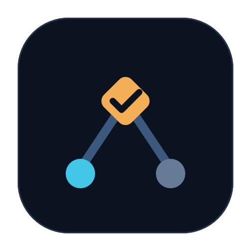

<p align="center"></p>

<h1 align="center">Baton</h1>

<p align="center"><a href="#回归"></a>
<a href="#"></a>
<a href="LICENSE"></a>
<a href="https://github.com/Lumos-789/baton"></a></p>

> OpenSpec 变更唯一的 ticket / DAG / 会话子代理控制面。
> 本地 CLI 返回确定性的会话动作；主会话用 DSH `subagent` 工具派发每个任务包、
> 绑定子代理 id，并依据密封回执（sealed receipt）结算完成通知。

**[Discussions](https://github.com/Lumos-789/baton/discussions)**

## 解决什么问题

OpenSpec 擅长规格驱动的分解（proposal -> tasks -> archive），但不负责执行。
Baton 把一个已批准的变更确定性地变成完成的工作：主会话从不自行决定 ticket 状态，
而是原样转发 Baton CLI 返回的确定性 `actions` 给 DSH 子代理，再把每个完成
通知对照**密封回执**（任务的验证命令在隔离 worktree 中全绿）结算。子代理的自由文本
输出不被采信。

密封回执是 `receipt.py` 在本地产生的哈希绑定证据（任务包哈希 + 干净前进的 HEAD +
退出码为 0 的验证结果）。整份回执正文由规范化 `sha256` 摘要（`receiptHash`）覆盖：
改动 `exitCode`、`changed_files`、`commit_sha`，或拿别的 ticket 的租约来顶替，
都会在集成前被拒。它是完整性证据，不是对抗恶意子代理的密码学证明（摘要没有密钥）。

三条接缝由确定性机制桥接：

| 接缝 | Baton 的答案 |
|---|---|
| 依赖（按 section 顺序的 DAG -> 下一步跑什么） | `SessionController.actions()` 每次调用重算前沿并原子认领不同任务 |
| 并发（<=5 个并行任务） | 每个任务一个隔离 git worktree；集成由仓库级锁串行化 |
| 状态（子代理结束 -> 任务完成） | 密封回执是唯一成功证据；控制器集成分支、落定尝试、回写 tasks.md 的 `[x]` |

**Baton 是指挥。`SessionController` 是唯一确定性调度器；主会话是机械转发器；
OpenSpec 是计划面。**

## 安装（DSH）

Baton 是一个 DSH bundle：一个包挂载 `baton` 技能，执行通过内置的 Python CLI
（`scripts/session_control.py`）完成。要求 DSH `0.2.1-rc.2` 或更新、提供
`subagent` 工具的 profile（自带的 `dsh-base` 即可）、PATH 上有 Python 3.10+。

```bash
# 从 checkout 安装
dsh plugin add /path/to/baton

# 发布后
dsh plugin add dsh-openspec-baton
```

自检（自包含，只需 `python3` + `git`；对临时 git 仓库驱动真实 CLI，健康则退出 0）：

```bash
python3 tests/cli_smoke.py
# CLI SMOKE PASS: actions dispatch, status snapshot, error exit - all green
```

包名用 `dsh-openspec-baton` 以避开无关的 `dsh-baton` 插件；仓库名与品牌保持
`baton`。

## 安装（ZCode）

同一仓库还带有 ZCode 插件形态（`.zcode-plugin/plugin.json`）：挂载同一份
`skills/baton/SKILL.md`，技能驱动同样的 `python3 scripts/session_control.py` CLI。
要求 `python3` 可达且为 Python 3.10+。

## 快速开始

在业务项目里按项目自身的 openspec 工作流写一个变更并获批：

```
openspec/changes/<change-id>/proposal.md + tasks.md   （未勾选的 N.M 任务）
```

`tasks.md` 就是 ticket 源：section 是阶段，任务带 `N.M` 编号，一个任务被它之前
所有 section 的任务阻塞（同一 section 内并行）。最小形态：

```markdown
# Tasks: add-login

## 1. 后端

- [x] 1.1 token 端点
- [ ] 1.2 会话持久化

## 2. 前端

- [ ] 2.1 登录表单
```

`[x]` = 已完成，`[ ]` = 就绪（没有草稿态）；精确解析规则见
[docs/ticket-format.md](docs/ticket-format.md)。

然后对会话说：

```
run baton on <project_path> <change-id>
```

技能会驱动 `actions` -> `subagent` -> `bind` -> 完成通知 -> `reconcile`，
直到批次返回 `complete`。

## 架构

```
主会话（机械转发器 — 不做任何模型驱动的状态决策）
  |- session_control.py <project> <change> actions --session-id ... --capacity<=5
  |     -> SessionController.actions()：恢复/结算密封回执、计算前沿、原子认领、
  |        准备隔离 worktree 与不可变任务包，返回
  |        dispatch/recover/resolve_merge/wait/blocked/complete 动作
  |- subagent(dispatch.prompt, cwd=dispatch.cwd) -> 子代理 id
  |- session_control.py <project> <change> bind <assignment_id> <claim_token> <agent_id>
  |- 运行时送达子代理完成通知
  `- session_control.py <project> <change> reconcile ... --agent-terminal ...
        -> 密封回执 -> 成功并集成；否则 unknown + recover

SessionController（唯一确定性调度器）
  |- 持久计划存储（.dsh/baton/queue.db）：修订、尝试、租约、密封回执、完成事实
  |- 隔离的任务 worktree + 共享集成 worktree
  |- 串行 git 集成；合并冲突保留（从不自动放弃）
  `- 按最新计划判定完成（全部必需 ticket 已验证并集成）
```

## 能力

**会话子代理执行**（唯一路径）：
- **确定性调度** — 认领、租约、worktree、回执验证、集成、完成判定全部脚本化，
  模型不决定状态。
- **隔离 worktree** — 每个任务一个分支；容量 <=5 的滑动窗口；集成由仓库级锁串行。
- **密封回执** — `scripts/receipt.py` 的 `verify` / `seal` 是唯一被采信的成功
  证据；没有回执的完成通知把尝试翻成 `unknown`。
- **固定 7200 s 租约** — 认领的租约硬编码为 7200 s（2 小时）：没有 CLI 开关，
  也没有续租入口。租约超时即判 `lease-expired`（尝试翻成 `unknown` 并带上该
  `failure_code`），下一次 `actions` 调用会重新派发该 ticket。
- **运维逃生口（双向带护栏）** — `abandon <assignment_id>` 退役卡住的尝试：释放
  租约、取消它参与结算的资格，但 worktree、分支、提交、任务包和回执都留在磁盘
  上供审计。对「可能还在干活」的尝试（在飞、无失败证据、无回执、租约消耗不足
  80%）abandon 默认拒绝并给出判定数据，`--force` 才放行——接手会话无法再悄悄
  销毁在飞的活。`adopt <assignment_id>` 是反向逃生口：abandon 之后迟到密封的
  回执可被复活——重新验证后正常入账，不再整票作废（同票已有后继密封证据时
  adopt 拒绝并列出两份证据，由人二选一）。
- **接力判定可读** — `status` 为每个尝试输出 `relay` 块：`elapsedSec` /
  `leaseRemainingSec` / `leaseElapsedFraction`、`receiptExists`、worktree
  存活信号与 `suggestedAction`（`wait` / `reconcile` / `adopt` / …）。派发
  prompt 要求子代理在 run 目录（worktree 之外，不会弄脏 seal）刷新
  `progress` 心跳文件，`status` 汇报其年龄——「活着」从数据里读，不靠猜。

**控制面**：
- **OpenSpec 原生的认知阶段** — “用 baton 完成 X” 指先跑项目的 OpenSpec 工作流
  （对齐 -> 写变更 -> 用户批准），再驱动执行到 `complete`。
- **活计划 = 直接改 tasks.md** — 运行中增删任务，下一次 `actions()` 记录新计划
  修订并重算前沿；在飞的任务包保持不可变。
- **验证是变更级且持久化** — `--verify "<cmd>"`（顶层参数，可重复）在首次认领时
  随本次运行持久化，之后的任务包（包括 `reconcile` 准备的）都复用它；再次传入
  即显式覆盖。不存在 per-task 验证覆盖。

**可观测性**：`scripts/ticket_board.py` 为项目的 OpenSpec 变更生成纯静态 HTML
看板（零进程、零端口）：

```bash
python3 scripts/ticket_board.py build-all /path/to/project
# -> .dsh/baton/board-all.html   （所有变更一板）
python3 scripts/ticket_board.py build /path/to/project <change-id>
# -> .dsh/baton/<change-id>/board.html
# 项目恰有一个变更时，build/scan 可省略 <change-id>——最常见的 day-one
# 情形；零个或多个变更时省略会 fail loud（点名所搜目录或列出候选）。
```

点击卡片会显示可复制的 `check` / `uncheck` 命令（任意目录可执行）；一次
翻转就会就地改写所有已构建的看板——刷新页面即可。

## 包内容

| 路径 | 用途 |
|---|---|
| `index.js` | 挂载内置 `skills/` provider |
| `cordis.patch.yml` | DSH bundle insert 行（`dsh-openspec-baton`） |
| `.zcode-plugin/plugin.json` | ZCode 插件清单（同一技能） |
| `skills/baton/SKILL.md` | `baton` 技能（actions -> subagent -> reconcile） |
| `scripts/session_control.py` | 控制面 CLI（`actions`/`bind`/`reconcile`/`status`/`cleanup`/`abandon`/`adopt`） |
| `scripts/` | 确定性控制器、计划存储、回执 |

## 历史

Baton v1 驱动外部的 `ralph.sh` 循环。v2 把循环搬进 Python。v3 用子代理替换了
子进程模型，但仍然依赖共享 PRD + `passes` 标记。v4 退役 PRD/passes 协议，让
`SessionController` 成为唯一确定性调度器。v5 把 OpenSpec 采纳为唯一的计划面：
变更的 `tasks.md` 就是 ticket 源（按 section 顺序的 DAG、`[x]` 回写），自建的
认知/修订引擎随之退役。**v6（当前）** 去掉本地 MCP 适配层：插件仍在迭代期，
CLI 是唯一的控制面。

## 要求

- **DSH** `0.2.1-rc.2` 或更新，且 `subagent` 可用（`dsh-base`）
- **Python 3.10+**（macOS/Linux 上的 `python3`、Windows 上的 `python`）+ pytest
- 一个 **git** 目标仓库（控制器要在其中准备隔离 worktree）
- 目标项目使用 **OpenSpec**（`openspec/changes/<id>/tasks.md`）

## 回归

标准回测入口 — 完整 pytest 套件（含临时 git fixture 的 e2e）、真实 CLI 冒烟、
文档/文件一致性检查：

```bash
./tests/regression.sh
```

## 文档

- [docs/architecture.md](docs/architecture.md) — 为什么确定性控制面是核心 IP
- [docs/ticket-format.md](docs/ticket-format.md) — OpenSpec 变更 -> ticket 映射规格

## 许可

MIT
