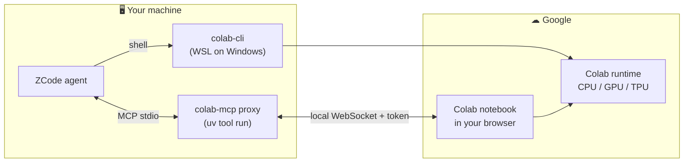

<div align="center">

# 🔬 Google Colab Tools for ZCode

**Google Colab, inside your AI agent — powered by Google's official open-source tools, built independently.**

A professional ZCode plugin integrating Google's official [colab-mcp](https://github.com/googlecolab/colab-mcp) browser-bridge MCP server and the [google-colab-cli](https://github.com/googlecolab/google-colab-cli) headless CLI — provision GPU/TPU runtimes, run code, and manage files on Google Colab without ever leaving your agent.

[](LICENSE)
[](CHANGELOG.md)
[](.github/workflows/validate.yml)
[](../../commits/main)
[](../../stargazers)
[](../../)
[](README.md#-installation)
[](scripts/)
[](https://modelcontextprotocol.io)
[](CONTRIBUTING.md)

</div>

---

## 📑 Table of Contents

- [Overview](#-overview)
- [How It Works](#-how-it-works)
- [Repository Layout](#-repository-layout)
- [Installation](#-installation)
- [Quick Start](#-quick-start)
- [Troubleshooting](#-troubleshooting)
- [FAQ](#-faq)
- [Development](#-development)
- [Roadmap](#-roadmap)
- [License & Notice](#-license--notice)
- [Acknowledgments](#-acknowledgments)

## 👁 Overview

| | |
|:---|:---|
| 🌉 **Browser bridge** | Pair ZCode with a live Colab notebook open in your browser via Google's official MCP proxy — inspect kernel state, run cells, iterate with the agent |
| ⚡ **Headless control** | Provision CPU/GPU/TPU sessions, execute scripts, upload/download artifacts with the official CLI — no browser required |
| 🧠 **Two skills** | `colab-mcp` (pairing flow, dynamic tools, troubleshooting) and `colab-cli` (full command reference, agent workflows) |
| 🛡 **No redistribution** | The MCP server is fetched at runtime from Google's official repo — this plugin ships configuration and expertise only |
| 🌐 **Bilingual skills, English docs** | Skills are pre-optimized for agent use; all documentation is in English |
| 🧪 **Validated** | 15-point repository validator runs locally and in CI on every push |

## 🔄 How It Works



**Two independent paths:** the MCP proxy pairs ZCode with a notebook you control in the browser, while the CLI provisions raw runtimes for fully automated jobs.

## 📁 Repository Layout

```
marketplace.json                       ← ZCode marketplace catalog
LICENSE                                ← Apache-2.0 full text
NOTICE.md                              ← legal notice (non-affiliation, attribution)
CHANGELOG.md                           ← version history
colab/
├── .zcode-plugin/plugin.json          ← plugin manifest (v0.1.2)
├── .mcp.json                          ← official colab-mcp server definition
└── skills/
    ├── colab-mcp/SKILL.md             ← browser pairing flow & troubleshooting
    └── colab-cli/SKILL.md             ← headless CLI command reference
scripts/
├── validate.py                        ← 15-point repository validator
└── smoke_colab_mcp.py                 ← MCP handshake smoke test
.github/workflows/validate.yml         ← CI: validates the repo on push & PR
```

## 🚀 Installation

1. In ZCode: **Plugin Marketplace → Add → Add Plugin Marketplace**
2. Paste the repository URL: `https://github.com/movtigroup/Colab-Plugin.git`
3. Install **Google Colab Tools** from the `movti-colab` marketplace
4. Restart ZCode so the MCP server starts fresh

### Requirements

| Requirement | Why | Install |
|---|---|---|
| [uv](https://docs.astral.sh/uv/) | Runs the MCP server | `pip install uv` |
| Google account | Access to colab.research.google.com | — |
| WSL *(Windows only)* | `google-colab-cli` targets Linux/macOS | `wsl --install` |

## ⚡ Quick Start

**Browser pairing** — select the `colab-mcp` skill and say:

> *"Connect me to Colab"*

The pairing tool opens Colab in your browser; after you sign in and the notebook connects back over WebSocket, the notebook's tools appear dynamically.

**Headless GPU job** — select the `colab-cli` skill:

```bash
colab new -s trainer --gpu A100          # provision a runtime
colab install -s trainer torch transformers
colab exec -s trainer -f train.py        # run code (contents sent to kernel)
colab download -s trainer checkpoints/model.bin ./model.bin
colab stop -s trainer                    # release the VM
```

## 🌐 Network Access & Dependencies

- **Network access**: `colab-mcp` starts a local WebSocket server and communicates with colab.research.google.com; `google-colab-cli` talks to the Google Colab API. At build time, uv fetches the official tools from PyPI and GitHub.
- **Command execution**: the MCP server is launched via `python -m uv tool run`; the `colab-cli` skill guides the agent to run `colab` commands.
- **File writes**: uv cache and Colab session metadata (`~/.config/colab-cli/`); `colab upload/download` reads and writes files on demand.
- **Third-party code**: fetched at runtime from [googlecolab/colab-mcp](https://github.com/googlecolab/colab-mcp) and [googlecolab/google-colab-cli](https://github.com/googlecolab/google-colab-cli) — both Google Apache-2.0 projects; nothing is redistributed in this repository.
- **Credentials**: none stored in the plugin; Google authorization happens in your browser session.

## 🛠 Troubleshooting

| Symptom | Fix |
|---|---|
| No Colab tools listed | Session not paired — invoke `open_colab_browser_connection`, keep the Colab tab open, and sign in to Google |
| Server fails to start | `pip install uv`, then restart ZCode |
| uvx build fails behind a mirror | Add `--index https://pypi.org/simple` to `.mcp.json` args |
| Pairing times out | Invoke the pairing tool again for a fresh 60-second window |
| colab-cli on Windows | Run inside WSL — Windows is not supported by the upstream CLI |

## ❓ FAQ

<details>
<summary><b>Is this made by Google?</b></summary>

No. This is an independent integration of Google's official open-source tools — see [NOTICE.md](NOTICE.md).
</details>

<details>
<summary><b>Where does the MCP server come from?</b></summary>

It is fetched at runtime from <a href="https://github.com/googlecolab/colab-mcp">googlecolab/colab-mcp</a> via <code>uv tool run</code>. Nothing is redistributed here.
</details>

<details>
<summary><b>Does it cost anything?</b></summary>

The Colab free tier works. GPU/TPU accelerators and high-RAM shapes consume Colab compute points (Pro/Pro+).
</details>

<details>
<summary><b>Why is the CLI Linux/macOS only?</b></summary>

That is an upstream limitation of <code>google-colab-cli</code>, documented by Google. On Windows, run it inside WSL.
</details>

## 🧪 Development

```bash
python scripts/validate.py          # 15-point repo validation
python scripts/smoke_colab_mcp.py   # live MCP handshake + tools/list test
```

CI runs the validator on every push and pull request.

## 🗺 Roadmap

- [x] Plugin foundation: MCP server, pairing and CLI skills, marketplace catalog
- [x] Professional packaging: license, notice, changelog, CI, validators
- [ ] Tagged releases surfaced in the ZCode marketplace
- [ ] Extra skills: Drive-mount workflows, compute-points monitoring

## 📄 License & Notice

Released under the [Apache License 2.0](LICENSE). Independent project — not affiliated with, endorsed by, or sponsored by Google. Legal details in [NOTICE.md](NOTICE.md), history in [CHANGELOG.md](CHANGELOG.md).

## 🙏 Acknowledgments

- [googlecolab/colab-mcp](https://github.com/googlecolab/colab-mcp) · © Google, Apache-2.0
- [googlecolab/google-colab-cli](https://github.com/googlecolab/google-colab-cli) · © Google, Apache-2.0

<div align="center">

**⭐ Star this repo if it saves you a GPU trip to the browser!**

</div>
