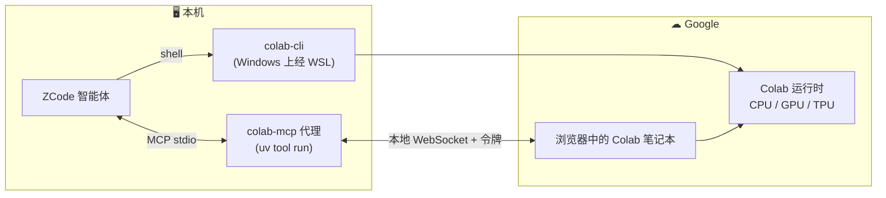

# 面向 ZCode 的 Google Colab 工具

**Google Colab，就在你的 AI 智能体中 — 由 Google 官方开源工具驱动，独立构建。**

面向 ZCode 的专业 Google Colab 集成：整合 Google 官方 [colab-mcp](https://github.com/googlecolab/colab-mcp) 浏览器桥接 MCP 服务器与 [google-colab-cli](https://github.com/googlecolab/google-colab-cli) 无头 CLI — 在不离开智能体的情况下创建 GPU/TPU 运行时、执行代码并管理 Colab 上的文件。

[](LICENSE)
[](https://github.com/movtigroup/Colab-Plugin/releases)
[](https://modelcontextprotocol.io)

## 概览

| | |
|:---|:---|
| 🌉 **浏览器桥接** | 通过 Google 官方 MCP 代理，将 ZCode 与你在浏览器中打开的 Colab 笔记本配对 — 检查内核状态、运行单元格、与智能体协作迭代 |
| ⚡ **无头控制** | 使用官方 CLI 创建 CPU/GPU/TPU 会话、执行脚本、上传/下载产物 — 无需浏览器 |
| 🧠 **两个技能** | `colab-mcp`（配对流程、动态工具、故障排除）与 `colab-cli`（完整命令参考、智能体工作流） |
| 🛡 **不重新分发** | MCP 服务器在运行时从 Google 官方仓库获取 — 本插件仅提供配置与使用知识 |
| 🌐 **双语文档** | 英文与中文文档齐备；技能针对智能体使用预先优化 |
| 🧪 **经过验证** | 15 项仓库校验器在本地与 CI 中运行 |

## 工作原理



**两条独立路径：** MCP 代理将 ZCode 与你在浏览器中控制的笔记本配对；CLI 则为全自动化任务创建原始运行时。

## 仓库布局

```
plugin.json / .mcp.json / skills/  ← 插件内容
LICENSE (Apache-2.0) / NOTICE.md   ← 许可与法律声明
README.md / README_CN.md           ← 双语文档
scripts/                           ← 校验器与 MCP 冒烟测试
.github/workflows/                 ← CI
```

## 安装

在 ZCode 中：**Plugin Marketplace → Add → Add Plugin Marketplace**，粘贴本仓库 URL 并安装 **Google Colab Tools**，然后重启 ZCode。

### 需求

| 需求 | 原因 | 安装 |
|---|---|---|
| [uv](https://docs.astral.sh/uv/) | 运行 MCP 服务器 | `pip install uv` |
| Google 账号 | 访问 colab.research.google.com | — |
| WSL（仅 Windows） | google-colab-cli 仅支持 Linux/macOS | `wsl --install` |

## 快速开始

**浏览器配对** — 选择 `colab-mcp` 技能并说：

> *"把我连接到 Colab"*

配对工具会在浏览器中打开 Colab；登录且笔记本通过 WebSocket 连回本地代理后，笔记本的工具会动态出现。

**无头 GPU 任务** — 选择 `colab-cli` 技能：

```bash
colab new -s trainer --gpu A100          # 创建运行时
colab install -s trainer torch transformers
colab exec -s trainer -f train.py        # 运行代码（内容直接发送到内核）
colab download -s trainer checkpoints/model.bin ./model.bin
colab stop -s trainer                    # 释放虚拟机
```

## 网络访问与依赖 / Network access and dependencies

- **网络访问**：`colab-mcp` 在本机启动 WebSocket 服务器并与 colab.research.google.com 通信；`google-colab-cli` 与 Google Colab API 通信。构建时 uv 会从 PyPI 与 GitHub 拉取官方工具。
- **命令执行**：MCP 服务器通过 `python -m uv tool run` 启动；`colab-cli` 技能指导智能体执行 `colab` 命令。
- **文件写入**：uv 缓存、Colab 会话元数据（`~/.config/colab-cli/`）；`colab upload/download` 按需读写文件。
- **第三方代码**：运行时从 [googlecolab/colab-mcp](https://github.com/googlecolab/colab-mcp) 与 [googlecolab/google-colab-cli](https://github.com/googlecolab/google-colab-cli) 获取，两者均为 Google 的 Apache-2.0 项目；本仓库不重新分发其源代码。
- **凭证**：无需在插件内存储任何凭证；Google 授权发生在你的浏览器会话中。

## 故障排除

| 现象 | 解决方法 |
|---|---|
| 看不到 Colab 工具 | 会话尚未配对 — 调用 `open_colab_browser_connection`，保持 Colab 标签页打开并登录 Google |
| 服务器启动失败 | `pip install uv`，然后重启 ZCode |
| uvx 构建失败（镜像环境） | 在 `.mcp.json` 参数中添加 `--index https://pypi.org/simple` |
| 配对超时 | 再次调用配对工具以获得新的 60 秒窗口 |
| Windows 上的 colab-cli | 在 WSL 中运行 — 上游 CLI 不支持 Windows |

## 常见问题

<details>
<summary><b>这是 Google 的产品吗？</b></summary>

不是。这是对 Google 官方开源工具的独立集成 — 见 <a href="NOTICE.md">NOTICE.md</a>。
</details>

<details>
<summary><b>MCP 服务器从哪里来？</b></summary>

在运行时通过 <code>uv tool run</code> 从 <a href="https://github.com/googlecolab/colab-mcp">googlecolab/colab-mcp</a> 获取。此处不重新分发任何内容。
</details>

<details>
<summary><b>有费用吗？</b></summary>

Colab 免费层可用。GPU/TPU 加速器与高内存规格消耗 Colab 算力点数（Pro/Pro+）。
</details>

<details>
<summary><b>为什么 CLI 仅限 Linux/macOS？</b></summary>

这是 <code>google-colab-cli</code> 的上游限制。在 Windows 上请在 WSL 中运行。
</details>

## 许可与声明

基于 [Apache License 2.0](LICENSE) 发布。独立项目 — 与 Google 无隶属、未获认可或赞助。法律细节见 [NOTICE.md](NOTICE.md)。
