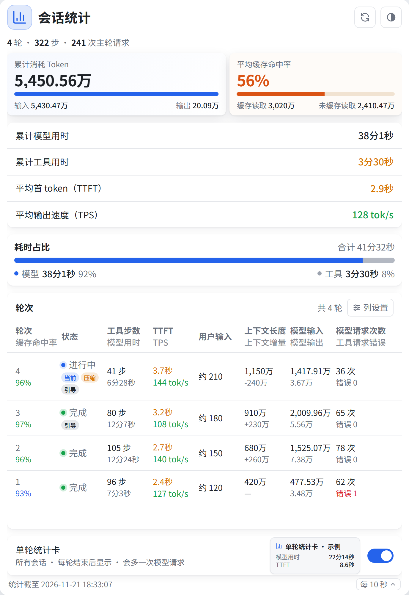

# TurnLens

English | [简体中文](README_CN.md)



TurnLens shows per-turn and session statistics for the current ZCode session:

| Metric | Meaning |
| --- | --- |
| Turns / steps | User turns / tool calls |
| Model time | Union of model request intervals (queueing, thinking and streaming; idle time excluded) |
| Tool time | Union of tool execution intervals; parallel tools count once |
| TTFT | Mean time to first token across main-turn model requests |
| TPS | Output tokens ÷ (request duration − TTFT), aggregated per request |

Data is read read-only from the local ZCode session database (default `~/.zcode/cli/db/db.sqlite`). Nothing is modified.

## Three ways to use it

### 1. Live side panel (v0.11.0)

The plugin registers an MCP Apps side panel that refreshes on a configurable interval (10 seconds by default):

- A footer dropdown sets the refresh interval to 5, 10, 30, or 60 seconds. It opens upward, defaults to 10 seconds, and is remembered in `localStorage["turnlens.pollMs"]`.
- Session totals: turns, steps, cumulative model/tool time, mean TTFT, mean TPS.
- Follows the ZCode theme: background, text, borders, speed colors, scrollbars and tooltip. The accent is a dedicated blue because ZCode's light theme maps `--color-text-info` close to black.
- A theme button right of refresh cycles four modes: follow ZCode (default), white light, dark, and high-contrast dark. The choice is remembered locally.
- The panel title follows the host locale: 会话统计 in Chinese, Session Stats in English.
- Compact numbers use 万 / 亿 above 10,000 / 100,000,000, with at most 2 decimals and thousands separators (`2,801.93万`, `1.42亿`).
- Time-share bar (model / tool) with duration and percentage in the legend.
- Tool time, TTFT and TPS are colored in five speed levels.
- The separate hero row is gone. A meta line above the summary shows turns, steps and main-turn requests; two large borderless cards show total consumed tokens (input/output split) and average cache hit rate (progress bar plus cache-read and uncached-read values). Total consumed = model input + model output; average cache hit rate is aggregated over the whole session as cache-read tokens ÷ model-input tokens, not an average of per-turn percentages. The panel itself has no outer vertical scrollbar; only the table scrolls.
- The same card language runs through the whole panel: the four metric rows, the time-share section, the turns table, and the setting card are borderless rounded surfaces with a softer shadow than the two summary cards.
- Per-turn table: turn + cache hit rate, status, 工具步数 / 模型用时, TTFT / TPS, 用户输入, 上下文长度 / 上下文增量, 模型输入 / 模型输出, 模型请求次数 / 工具请求错误. Turn and status can also be toggled in **列设置** like any other column and follow the alignment setting, which defaults to left. Cache hit rate is a second line under the turn number and is graded ≥95% green, ≥85% blue, ≥70% amber, ≥50% orange, <50% red. When context delta is negative, the status column shows a 压缩 badge on the same badge row as 当前. Header labels never wrap; all columns default to an equal 70px, so a 688px pane fits and a narrower pane scrolls horizontally. Drag a header boundary to resize a column; widths are remembered, and 列设置 can restore the defaults. Paired headers use a muted second line with no rule; the status dot keeps its colored halo; TTFT/TPS use five speed colors; each cell has a single merged tooltip, tooltips have equal left/right padding, multi-line content is always rendered as a hanging-indent bullet list, and large token values use 万/亿.
- Guided input (sending a message while a turn is still running) does not create a new row. The same turn keeps one row, shows a 引导 badge, and its user-input estimate includes the guided text. ZCode splits guided turns into work segments and shows the latest segment's wall-clock work time; the model-time tooltip shows both the whole-turn model time and that latest segment duration.
- **User input** is estimated from the user message text (CJK ≈ 1 token per character, other text ≈ 4 characters per token). It is not the model's context token count; the context length is shown separately, and cache hit rate is cache-read tokens ÷ model-input tokens.
- A mini card illustration in the bottom **单轮统计卡** setting card shows what the optional card looks like.
- The **单轮统计卡** switch is a global preference. Turning it off stops automatic cards in every session.
- The panel calls the local stats script directly through the plugin's MCP server: **no model request, no tokens consumed**.

To open it: in the ZCode sidebar click **+** → **New tab** → **View all plugins** → **TurnLens** (icon `chart-column`), then keep the tab pinned. This path costs nothing. You can also run `/turn-lens-panel` (or the legacy `/session-stats-panel`); the model calls `open_session_stats` and the host opens the panel in the side pane, at the cost of one short model request.

> The “App plugins” recommendation grid on the new-tab page is populated by ZCode's remote `uiPluginRecommendations` config, not by a plugin manifest. A plugin cannot register itself there; local plugins appear under “View all plugins”.

### 2. Automatic single-turn card (v0.2.0, switchable)

When enabled, a Stop hook runs at the end of each turn and asks the assistant to print a card for **that turn** (not the session total). It includes model/tool time, TTFT, TPS, context input, estimated user input, output, main-turn requests and tool errors.

- Cost: one extra short model request per turn (a few seconds, a few hundred output tokens).
- Side effect: ZCode treats the continuation as the last assistant message of the turn, so the original main reply may be collapsed. This is inherent to the Stop-hook API, which can only append one model request.
- If you care more about keeping the main reply expanded, turn the card off and use the side panel (zero extra requests).
- Global switch: **单轮统计卡** at the bottom of the panel. It writes `~/.zcode/cli/plugins/data/turn-lens/auto-display.json`, shared by the panel and the hook.
- Manual opt-outs: `SESSION_STATS_AUTO_DISABLED=1`, `<project>/.zcode/session-stats.auto-off`, or `<plugin data dir>/auto-display.disabled`.
- No loop: the hook checks `stop_hook_active` and skips when the previous reply already contains a card (`📊 单轮统计卡`).
- Subagent sessions are skipped; if no usage data exists, the hook exits silently.

### 3. On demand

```
/turn-lens
```

The legacy `/session-stats` command is kept as an alias. Common arguments:

```
/turn-lens --details              # append the per-turn detail table
/turn-lens --session-totals       # show session totals
/turn-lens --include-active       # include the in-progress turn
/turn-lens sess_42d97868...       # select a session
/turn-lens --json                 # output JSON
```

By default the command shows the latest turn; `--session-totals` shows the whole session. Only completed turns are counted unless `--include-active` is passed. The side panel always includes the active turn and its summary is the session total.

## Metric definitions

- Only main-turn model requests are counted. Title generation, context compaction and subagent sessions are excluded; a subagent session must be selected explicitly with `--session <id>`.
- Model time = union of `[started_at, completed_at]` intervals in `model_usage`; active requests use the current time. Idle time between requests is not counted.
- Tool time = union of `[started_at, completed_at]` intervals in `tool_usage`; parallel tools count once.
- TTFT = arithmetic mean of `time_to_first_token_ms` over completed main-turn requests.
- TPS = Σ output tokens ÷ Σ (request duration − TTFT), only for requests with `duration_ms > TTFT` and positive output.

## Requirements

- Node.js 22.5+ (the script uses the built-in `node:sqlite`; no third-party runtime dependencies).
- The database is opened read-only and can be read while ZCode is running.
- The panel requires ZCode's MCP Apps host (ZCode 3.19+).

## Author and privacy

- Author: MorganWsy
- Contact: shuyang@email.ncu.edu.cn
- License: MIT, see `LICENSE`.
- Reads `~/.zcode/cli/db/db.sqlite` read-only; no network requests, no uploads, no database writes.
- The Stop hook is the only feature that adds a model request; turn it off from the panel if you do not want it.

## Install

Install **TurnLens** from the ZCode plugin marketplace, then start a new session so the hook and MCP server definitions load. Open the panel from **+ → New tab → View all plugins → TurnLens**, or run `/turn-lens-panel`.

## Layout

```
dist/server.mjs                 # MCP stdio server (panel data source)
dist/ui/panel.html              # built panel
skills/turn-lens/SKILL.md
skills/turn-lens/scripts/session-stats.mjs
hooks/hooks.json
hooks/stop.mjs
commands/
assets/
```
