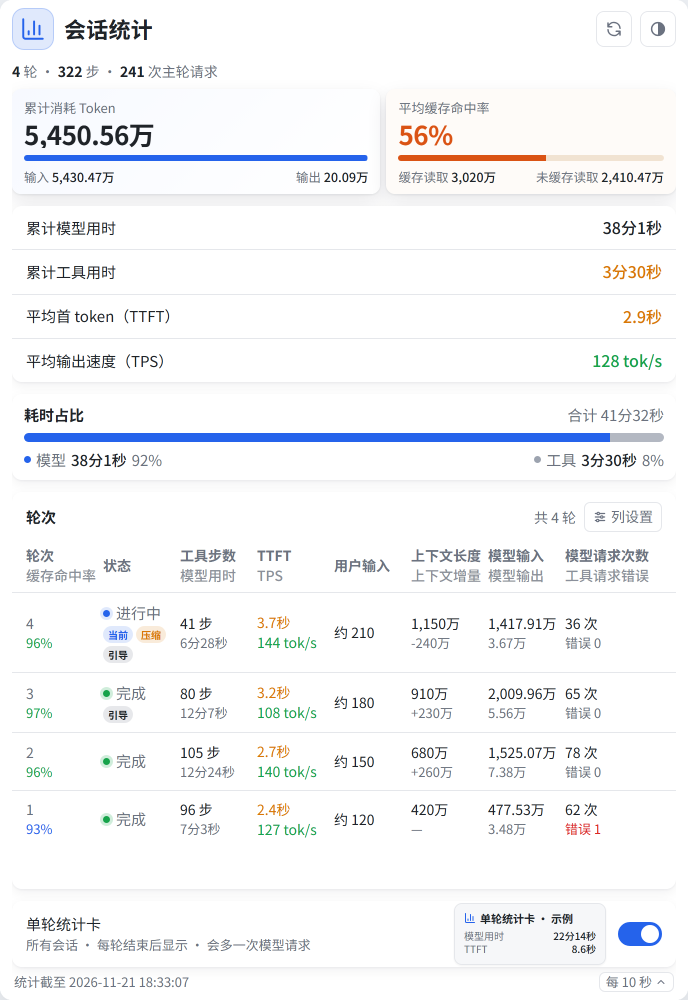

# TurnLens

[English](README.md) | 简体中文



在 ZCode 里查看当前会话的单轮与累计统计：

| 指标 | 说明 |
| --- | --- |
| 轮 / 步 | 用户轮次 / 工具调用次数 |
| 模型用时 | 模型请求区间的并集（含排队、思考、流式输出，不含空闲等待） |
| 工具调用用时 | 工具执行区间的并集；并行工具只算一次 |
| 首 token 平均（TTFT） | 主轮模型请求首 token 延迟的平均值 |
| 输出速度（TPS） | 输出 tokens ÷（请求耗时 − TTFT），按请求汇总 |

数据以只读方式来自本地 ZCode 会话数据库（默认 `~/.zcode/cli/db/db.sqlite`），不会修改任何内容。

## 三种查看方式

### 1. 侧栏实时面板（v0.11.0）

插件注册了一个 MCP Apps 侧栏面板，默认每 10 秒自动刷新，刷新频率可调：

- 底部下拉框可选择 5 / 10 / 30 / 60 秒的刷新频率，向上展开，默认 10 秒，选择写在 `localStorage["turnlens.pollMs"]`。
- 汇总累计轮数 / 步数，以及累计模型用时、累计工具用时、平均 TTFT、平均 TPS。
- 跟随 ZCode 主题：背景、文字、边框、速度色、滚动条和提示气泡都使用宿主主题变量。强调色使用固定蓝色系，因为 ZCode 浅色主题的 `--color-text-info` 接近黑色，直接使用会让图标和徽标发黑。
- 刷新按钮右侧有主题按钮，循环 4 档：跟随 ZCode（默认）、白色浅色、深色、高对比度深色。选择会记住。
- 面板标题跟随宿主语言：中文显示「会话统计」，英文显示「Session Stats」。
- 数值超过 1 万用「万」、超过 1 亿用「亿」，最多 2 位小数，并带千分位（例如 `2,801.93万`、`1.42亿`）。
- 耗时占比条（模型 / 工具），图例同时给出时长和百分比。
- 工具用时、TTFT、TPS 按快慢显示 5 级颜色。
- 顶部不再单独占一行放轮次/步数；汇总区上方的小字显示轮次、步数和主轮请求，下面是两张**无边框**主卡：累计消耗 Token（输入/输出拆分）和平均缓存命中率（进度条 + 缓存读取/未缓存读取）。累计消耗 = 模型输入 + 模型输出；平均缓存命中率按整个会话汇总缓存读取 tokens ÷ 模型输入 tokens，不是各轮百分比的算术平均。面板本身不出现纵向滚动条，只有轮次表内部滚动。
- 其余区域沿用同一套卡片语言：四行指标、耗时占比、轮次表和底部设置卡都是无边框圆角卡片，阴影比两张汇总主卡更轻。
- 每轮明细：轮次 + 缓存命中率、状态、工具步数 / 模型用时、TTFT / TPS、用户输入、上下文长度 / 上下文增量、模型输入 / 模型输出、模型请求次数 / 工具请求错误。轮次和状态也可以像其他列一样在「列设置」里开关，并参与左/中/右对齐，默认左对齐；缓存命中率是轮次下方的第二行，并按 ≥95% 绿、≥85% 蓝、≥70% 黄、≥50% 橙、<50% 红分级着色；上下文增量小于 0 时状态列显示「压缩」徽标，和「当前」徽标同排。表头每一行都不换行；默认所有列等宽 70px，688px 可完整显示，窄侧栏横向滚动；列宽可以拖动表头边界调整并记住，列设置里可恢复默认。成对表头用第二行弱化区分，无分隔线；状态圆点保留彩色光晕；TTFT/TPS 按 5 级速度着色；每个格子只有一个合并后的气泡，气泡左右内边距一致，多段内容统一显示为带悬挂缩进的圆点列表，大数用万/亿。
- 引导输入（上一轮还在进行时又发送消息）不会新建轮次行：同一轮仍是一行，状态列显示「引导」徽标，用户输入估算包含引导文本；ZCode 会把引导轮拆成多个工作分段并显示最新一段的墙钟工作时间，模型用时气泡会同时列出整轮模型用时和该分段时长。
- **用户输入**是按用户消息文本估算的（CJK 约 1 字≈1 token，其他约 4 字符≈1 token），不是模型请求的上下文 tokens；上下文长度单独显示，缓存命中率 = 缓存读取 tokens ÷ 模型输入 tokens。
- 底部「单轮统计卡」设置卡里有一张迷你卡片示意图，展示开启后卡片的样子。
- 「单轮统计卡」是**全局开关**，关闭后所有会话都不再自动输出卡片。
- 面板通过插件自带的 MCP server 调用本地统计脚本，**不经过模型，不消耗 tokens**。

打开方式：ZCode 侧栏「+」→「新标签页」→「查看所有插件」→ **TurnLens**（图标 `chart-column`），然后把标签页固定。这条路径零额外请求。也可以输入 `/turn-lens-panel`（兼容旧命令 `/session-stats-panel`），模型调用 `open_session_stats`，宿主会把面板打开到侧栏，但会有一次很短的模型请求。

> 新标签页「应用插件」区域的推荐位由 ZCode 客户端的 `uiPluginRecommendations` 远程配置决定，插件无法自己注册进去；本地插件只能出现在「查看所有插件」里。

### 2. 单轮统计卡（v0.2.0，可开关）

开启后，Stop hook 在每轮结束时运行脚本，让助手输出**本轮**（不是会话累计）的统计卡：模型/工具用时、TTFT、TPS、上下文输入、用户输入估算、输出、主轮请求和工具错误。

- 代价：每轮多一次很短的模型请求（约几秒、几百 output tokens）。
- 副作用：ZCode 会把这次续写当成该轮最后一条助手消息，原本的主回复可能被折叠。这是 Stop hook API 只能“追加一次模型请求”的固有限制。
- 如果更在意主回复的展开状态，建议关闭统计卡，改用侧栏面板（零额外请求）。
- 全局开关：面板底部的「单轮统计卡」。设置写入 `~/.zcode/cli/plugins/data/turn-lens/auto-display.json`，面板和 hook 共用。
- 手动关闭（任选其一）：`SESSION_STATS_AUTO_DISABLED=1`、项目下 `.zcode/session-stats.auto-off`、插件数据目录 `auto-display.disabled`。
- 不会循环：hook 检查 `stop_hook_active`；上一轮回复已包含统计卡（`📊 单轮统计卡`）时跳过。
- 子智能体会话跳过；无用量记录时静默退出。

### 3. 按需查看

```
/turn-lens
```

旧命令 `/session-stats` 保留为别名。常用参数：

```
/turn-lens --details              # 追加每轮明细表
/turn-lens --session-totals       # 显示整个会话的累计统计
/turn-lens --include-active       # 把当前进行中的轮次也算进去
/turn-lens sess_42d97868...       # 指定会话
/turn-lens --json                 # 输出 JSON
```

默认显示最新一轮；`--session-totals` 显示整个会话。默认只统计已完成的轮次，加 `--include-active` 才包含进行中的轮次。侧栏面板始终包含进行中的轮次，汇总区展示会话累计。

## 指标口径

- 只统计主轮模型请求；不含标题生成、上下文压缩和子智能体会话。子智能体会话需要显式用 `--session <id>` 指定。
- 模型用时 = `model_usage` 中 `[started_at, completed_at]` 区间的并集；进行中的请求用当前时间。请求之间的空闲时间不计入。
- 工具调用用时 = `tool_usage` 中 `[started_at, completed_at]` 区间的并集；并行工具只算一次。
- TTFT = 已完成主轮请求 `time_to_first_token_ms` 的算术平均。
- TPS = Σ 输出 tokens ÷ Σ（请求耗时 − TTFT），只用 `duration_ms > TTFT` 且输出大于 0 的请求。

## 依赖与限制

- 需要 Node.js 22.5+（脚本使用内置 `node:sqlite`，无第三方运行时依赖）。
- 数据库以只读方式打开；ZCode 正在运行时也能读取。
- 面板依赖 ZCode 的 MCP Apps 宿主能力（ZCode 3.19+）。

## 作者与隐私

- 作者：MorganWsy
- 联系：shuyang@email.ncu.edu.cn
- 许可证：MIT，见 `LICENSE`。
- 只读本地 `~/.zcode/cli/db/db.sqlite`；不联网、不上传数据、不修改数据库。
- Stop hook 是唯一会增加模型请求的功能；不需要时可在面板底部关闭。

## 安装

在 ZCode 插件市场安装 **TurnLens**，然后新建会话以加载 hook 和 MCP 服务定义。侧栏「+」→「新标签页」→「查看所有插件」→ **TurnLens** 打开面板，或运行 `/turn-lens-panel`。

## 目录

```
dist/server.mjs                 # MCP stdio server（面板数据源）
dist/ui/panel.html              # 构建后的面板
skills/turn-lens/SKILL.md
skills/turn-lens/scripts/session-stats.mjs
hooks/hooks.json
hooks/stop.mjs
commands/
assets/
```
