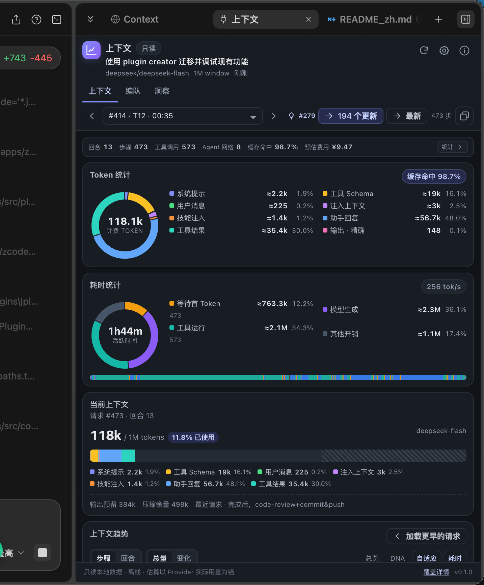
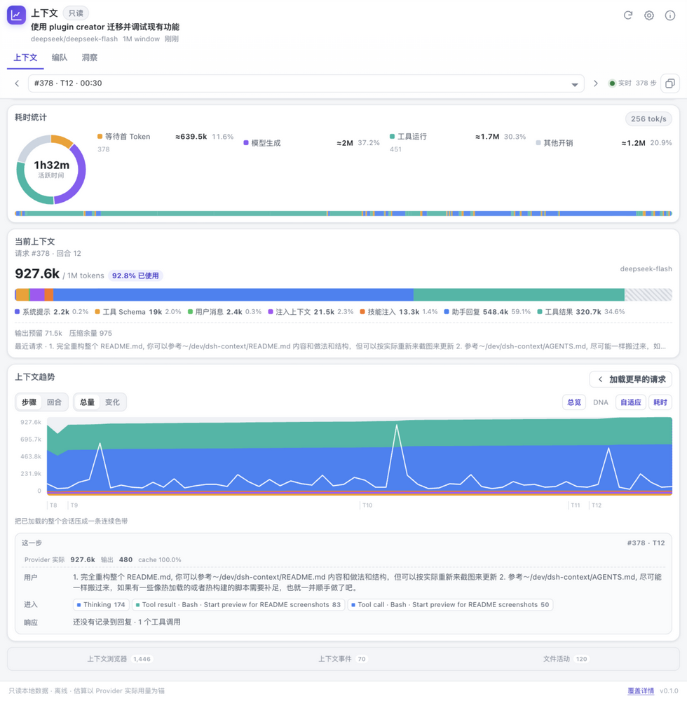
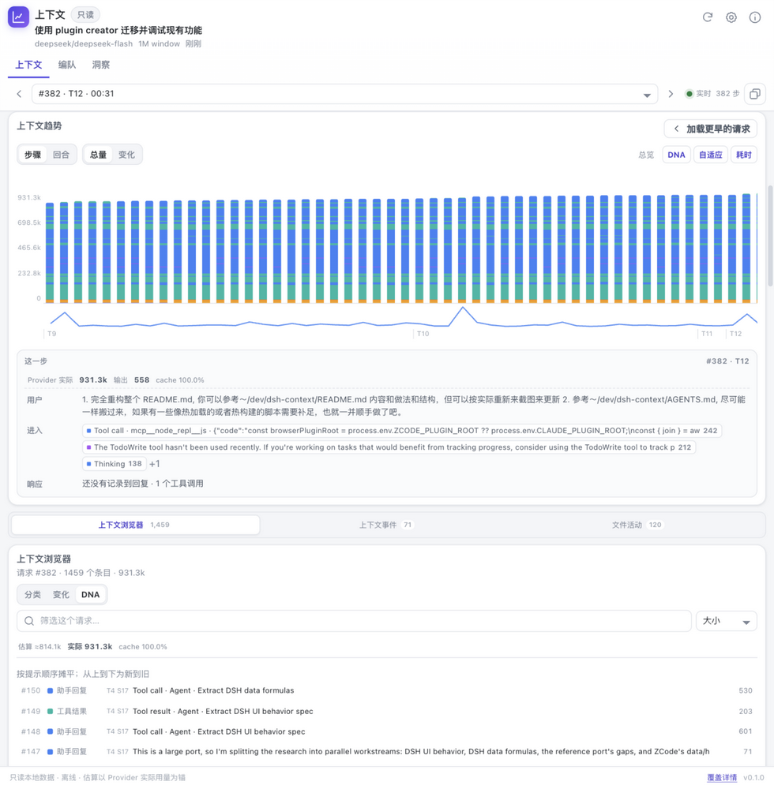
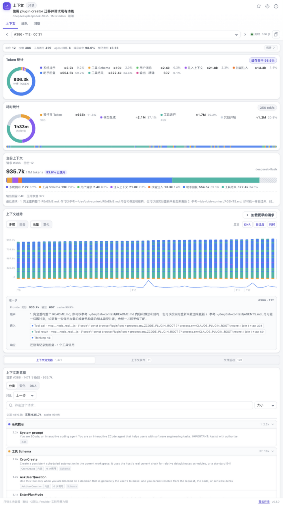
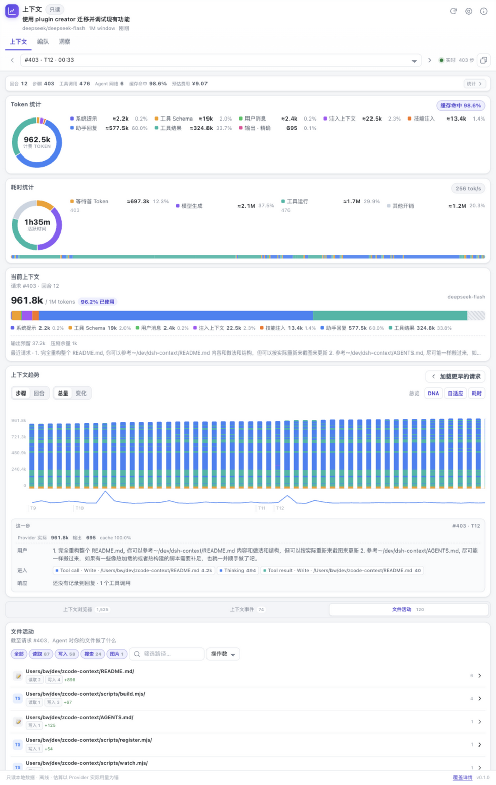
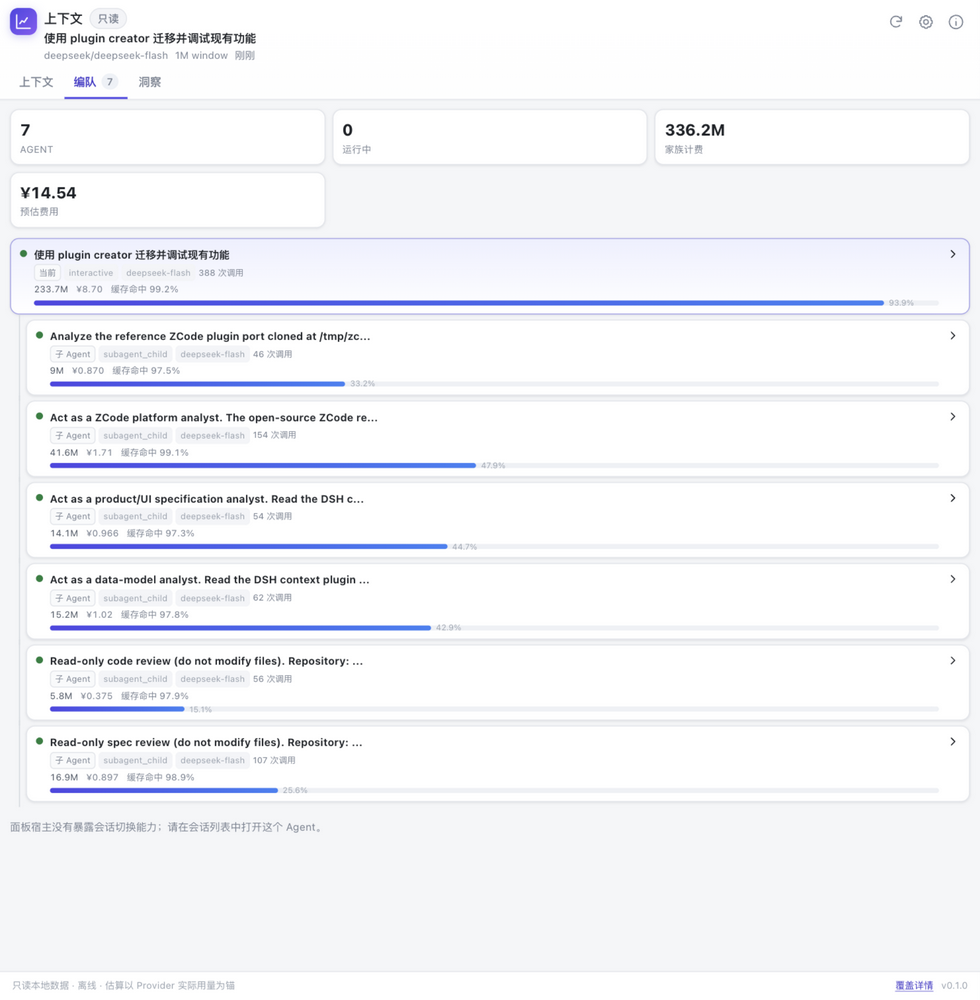
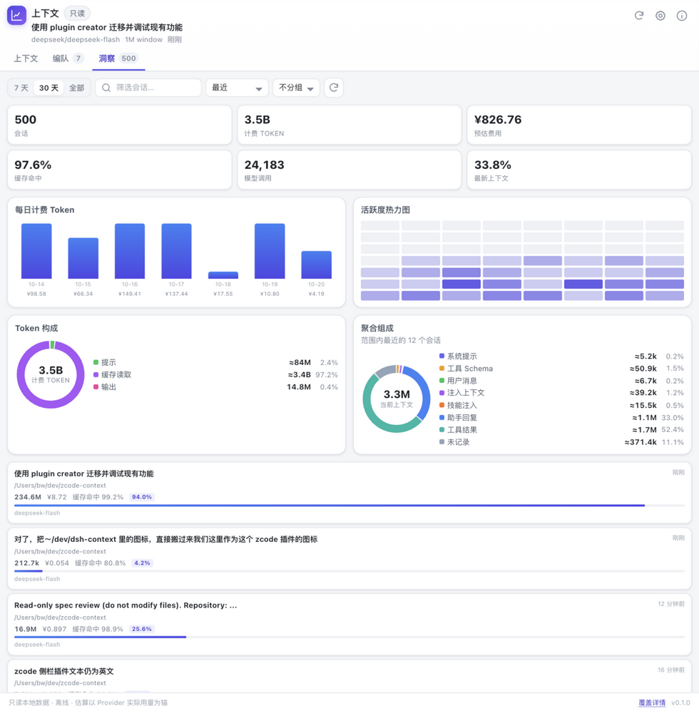
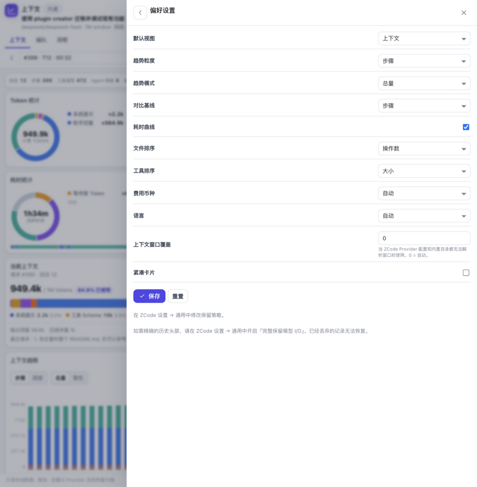

# ZCode 上下文洞察插件 zcode-context-insight

[English](README.md)

**Apache-2.0 · ZCode Desktop 3.15.1+ · Node.js 24+ · Read-only · Offline**

**面向 ZCode 的上下文洞察与管理面板，功能与交互改编自 [dsh-context](https://github.com/bowenliang123/dsh-context)。**

`zcode-context-insight` 把 ZCode 已经记录在本机的数据变成会话侧栏：

- **上下文**：当前请求的紧凑仪表盘，包括组成、Token 统计、耗时统计、逐请求趋势、请求浏览器、上下文事件与文件活动。
- **编队**：当前 Agent、父级、兄弟与所有子 Agent，含运行状态、计费 Token、预估费用与上下文占用。
- **洞察**：跨会话用量、KPI、7 日图、8 周热力图、Token 构成、聚合组成与可搜索的会话卡片。
- **`/context`**：不离开对话即可获得当前会话的只读报告。
- **偏好设置**：趋势、排序、币种、语言与上下文窗口覆盖的每用户默认值。

它只读、离线：不修改会话、不调用模型、不访问网络。

## 安装 / 更新

**要求：** ZCode Desktop **3.15.1+**（需要官方 MCP Apps UI 契约），以及 `PATH` 中可用的 **Node.js 24+**（`node -v`）。运行时依赖已打进 `dist/`，安装后不需要 npm 或构建工具。

### 从 ZCode 插件市场安装

在 **设置 → 插件管理** 中安装 **zcode-context-insight** 并启用。打开任意会话，点击右侧面板的 **+**，选择 **上下文**。

### 本地开发目录（standalone 仓库）

```sh
npm install
npm run build
npm run package
```

`npm run package` 会把可安装插件写到 `plugins/zcode-context-insight/`，并在 `plugins/marketplace.json` 生成本地市场目录。

1. 打开 **设置 → 插件管理 → 发现**。
2. 添加 `<checkout>/plugins` 的绝对路径作为插件市场。
3. 安装 **zcode-context-insight**，然后启用。
4. 如果安装时 ZCode 已经在运行，重启一次应用。
5. 打开任意会话，点击右侧面板的 **+**，选择 **上下文**。

更新：执行 `npm run build && npm run package`，刷新市场，然后重新安装/更新插件。请保留同一个本地市场名称。

开发时，`npm run watch` 会在文件变化后重建，并把运行时同步到已安装的插件缓存。只改 UI 时，关闭再重新打开面板即可；改动服务端或 Worker 后需要重启 ZCode。

### 从 GitHub 安装（standalone 仓库）

把 `bowenliang123/zcode-context-insight`（或完整仓库 URL）添加为插件市场，安装 **zcode-context-insight** 并启用。在 standalone 仓库中，根目录的 `marketplace.json` 指向 `plugins/zcode-context-insight` 下的打包产物。

## 使用

上下文面板沿用 DSH 的右侧栏排布：紧凑指标条、Token 统计、耗时统计、当前上下文与上下文趋势。浏览器、上下文事件与文件活动收在趋势下方的轻量详情切换中，让侧栏保持可读。


| 区域 | 回答什么 |
| --- | --- |
| **指标条** | 回合、步骤、工具调用、Agent 网络规模、缓存命中率、预估费用；可展开完整统计卡片。 |
| **Token 统计** | 计费 Token 去了哪里：按组成拆分，并以 Provider 精确的输出量收口。 |
| **耗时统计** | 活跃时间如何分配到首 Token 等待、模型生成、工具运行与其他开销。 |
| **当前上下文** | 窗口此刻装了什么，以及相对模型窗口的占用、输出预留与压缩余量。 |
| **上下文趋势** | 每个请求一根柱：步骤/回合、总量/变化、连续总览、DNA 指纹、自适应缩放与耗时曲线。 |
| **上下文浏览器** | 任意选中请求由什么组装而成：分类、搜索、排序、变化、DNA 顺序与完整条目内容。 |
| **上下文事件** | 注入、压缩、模型切换与回退，可下钻查看一次压缩摘要了什么。 |
| **文件活动** | 读取、写入与搜索的路径、行数差值与逐操作日志。 |

顶部步骤选择器可固定一个请求。**加载更早的请求** 扩展已加载窗口。阅读历史时若有新请求到达，面板提供 **N 个更新** 与 **最新**，不会抢走你的选择。

### 🧱 当前上下文

相对解析出的上下文窗口绘制分段条：系统提示、工具 Schema、用户消息、注入上下文、技能注入、助手回复与工具结果，各自标注 ≈Token 与占比。斜线阴影尾部是输出预留，剩余空间是压缩余量。

Provider 报告的提示总量锚定整条分段条，因此头部数字与请求账单一致。较早请求若未保留系统提示和工具 Schema，面板会明确说明，并把缺失的余量标为 **未记录**，而不是编造拆分。

### 📈 上下文趋势



- **步骤 / 回合** — 每个模型请求一根柱，或用回合内最后一个请求表示一个回合。
- **总量 / 变化** — 累计组成，或相对上一条记录的有符号变化。
- **总览** — 把整个已加载会话画成一张连续堆叠面积图，按会话内最大值缩放。图上有五个刻度、回合标签与耗时曲线；悬停可扫查，点击可固定。它不是每个请求都归一化为 100% 的色带：增长与压缩造成的下降都会保留。
- **DNA** — 最新的 120 根已加载趋势柱变成逐条目指纹，同时浏览器切换到摊平的 DNA 列表；更早的柱子保留分类颜色。条带按紧凑的逐请求序列获取，并在轮询刷新之间保留。



- **自适应** 按可见最大值缩放图表；**耗时** 叠加每个请求的活跃时间。
- **悬停与固定** — 扫查请求提示；点击固定该步骤。图表下方的简述显示 **用户 / 进入 / 响应**、Provider 的 **实际提示 / 输出 / cache**，并可打开浏览器中对应的精确条目。

### 🧭 上下文浏览器



可选择 **分类**、**变化** 或 **DNA**：

- **分类** — 可折叠分组、Token 合计、条目数与变化徽标。支持搜索、按大小/名称/提示顺序/调用次数排序，以及继续加载。
- **变化** — 将选中请求与上一步或上一回合对比：新增、移除、修改，并带 Token 差值。
- **DNA** — 按提示顺序摊平的列表，最新在上，显示位置、分类、引入步骤与 Token 代价。

点击任意条目可阅读其完整内容：系统提示、工具 Schema、消息正文、推理、工具参数与结果正文。工具卡片包含状态、参数表、原始 JSON 与 Markdown/文本视图；大内容分页加载。

工具 Schema 行带有来源标签（`built-in`、`plugin` 或 `mcp:<server>`）与调用次数。助手分类可按 **思考 / 工具 / 回答** 筛选。

### ⚡ 上下文事件

每次运行时注入、压缩、模型切换与回退都会列出其生产者、净 Token 变化、步骤与时间。筛选标签覆盖当前会话中实际出现的事件类型。

点击一次压缩可打开 **被摘要的内容**：压缩前后 Token、被摘要与保留的条数、耗时，以及活动分支上的消息。浏览器可对比压缩前后的请求。中断或没有边界的压缩会明确说明摘要内容不可用，而不是报错。

### 📁 文件活动



从详情切换中打开 **文件活动**：

- 读取 / 写入 / 搜索 / 图片筛选，以及路径搜索。
- 按操作数、最近、路径、名称或新增行排序。
- 展开文件查看逐操作日志；每次操作可跳转到对应的工具结果。
- 编辑使用记录中的精确增删行数；写入回退到内容行数；由 Shell 推断的操作会标注为估算。

## 🚢 编队



打开 **编队** 标签，当前 Agent、父级、兄弟与所有后代各显示为一张卡片：

- 角色（当前 / 父级 / 兄弟 / 子 Agent）、任务类型与模型；
- 计费 Token、预估费用与缓存命中率；
- 最新上下文大小与占用；
- 运行 / 完成 / 错误状态，运行中的 Agent 带脉冲。

点击卡片查看初始提示、最新回复、用量、耗时与直接子级。面板宿主没有提供会话切换，因此编队是信息视图；请从 ZCode 的会话列表打开另一个会话。

## 🗂️ 洞察



**洞察** 标签聚合本地存储中的跨会话数据：

- **KPI** — 会话数、计费 Token、预估费用、缓存命中率、模型调用数与平均最新上下文。
- **7 日图** — 每日计费 Token 与预估费用。
- **热力图** — 最近 8 周的每日计费 Token；点击某天可筛选会话卡片。
- **Token 构成** — 提示、缓存读取与输出。
- **聚合组成** — 最近 12 个会话的合计，并标明会话数。
- **会话卡片** — 标题、工作区、模型、Token、费用、缓存命中与上下文占用；支持范围、搜索、排序与按工作区分组。

范围、日期、搜索与排序作用于会话卡片。用量只来自本地仍保留用量行的会话，面板会明确说明；如果载荷预算裁剪了卡片列表，面板也会说明当前展示了多少个会话（共多少）。

## ⌨️ `/context`

在输入框输入 `/context`。插件的模型可见工具 `get_context_report` 读取当前会话并返回紧凑报告：提示大小、占用、组成、计数、费用、最近事件与数据覆盖。命令要求 Agent 如实呈现，不编造数字；完整交互浏览器仍在面板中。

## ⚙️ 偏好设置



齿轮按钮打开每用户偏好：

- 默认视图、趋势粒度与模式、对比基线；
- 耗时曲线、文件与工具排序；
- 币种与语言；
- 上下文窗口覆盖（当 ZCode Provider 配置与内置目录都无法解析时）；
- 紧凑卡片。

偏好保存在插件数据目录（`ZCODE_PLUGIN_DATA`，或 `~/.zcode/zcode-context-insight/preferences.json`），不会修改会话。

## 需要知道的细节

**估算与实测。** 分类数字使用按字符脚本加权的启发式（约 4 个 ASCII / 1.5 个 CJK / 2 个其他字符每 Token），并锚定到 Provider 报告的提示总量。提示、输出与缓存计数是精确值。趋势提示与简述会把 Provider 实测值显示在估算值旁边。

**上下文窗口。** 解析顺序：你的覆盖 → ZCode 的 Provider 配置 → 内置 models.dev 快照 → 未知。未知窗口保持未知，面板不会伪造百分比。费用是同一离线快照的标价估算；未知模型显示 `—`。

**消息与头部。** 消息组成从 ZCode 完整的 SQLite 会话存储重建，包括工具调用/结果、合成提醒、压缩摘要、图片与附件。系统提示与工具 Schema 来自模型 I/O 轨迹。在 ZCode 默认的有界保留下，较早的头部可能由最近的已记录请求近似；覆盖卡片与页脚会明确说明。

**保留策略。** 如需精确的历史头部，请开启 **设置 → 通用 → 完整保留模型 I/O**。它只影响未来请求，已经丢弃的记录无法恢复；插件不会修改这个设置。

**压缩与回退。** 压缩之后的请求会排除被摘要的消息；条目跟随活动回退分支，而会话级计数与历史活动仍按整个会话统计。

**适配限制。** ZCode 只暴露会话级 `ui.surfaces`，因此编队与洞察是面板内标签，而不是一级侧栏页；宿主也没有会话切换 API。插件无法注入提示词前缀/后缀。DNA 强制使用总量模式（不支持逐条目 DNA Delta），覆盖最新的 120 个已加载请求。图片与文件附件只显示元数据与已记录的文本；不加载外部资源。编队的会话跳转、文件预览等行为因此与 DSH 不同。

**国际化。** English 与简体中文。

## 开发

下列命令属于 standalone 仓库。在官方市场的源码包里，从市场仓库根目录执行 `pnpm install --frozen-lockfile` 和 `pnpm build`，测试用 `node --test test/*.test.mjs`。

```sh
npm install          # esbuild + MCP SDK
npm run build        # dist/server.mjs, dist/worker.mjs, dist/context.html
npm run watch        # 文件变化后重建，并同步已安装的开发插件
npm run register     # 构建、打包、注册并启用本地插件
npm test             # domain 测试
npm run check        # manifest、构建产物、语法与环境检查
npm run smoke        # 本地真实数据库 smoke
npm run mcp-smoke    # stdio MCP 握手、工具、会话绑定、洞察
npm run preview      # 基于真实只读服务的浏览器预览
npm run test-host    # MCP Apps AppBridge + iframe 握手
npm run package      # 打包插件 + 本地市场
```

`npm run preview` 在 `127.0.0.1:4180` 提供构建后的面板，使用真实本地数据；可加 `?theme=dark` 或 `?lang=en`。`npm run test-host` 通过真实的 `@modelcontextprotocol/ext-apps` AppBridge 在 `127.0.0.1:4190` 提供同一面板。

watch 细节：只改 UI 时，关闭再重新打开上下文面板即可（面板打开时会重新读取 MCP 资源）。改动服务端或 Worker 后需要重启 ZCode，因为运行中的 MCP 进程会保留旧模块图。

关键路径：

```text
src/server.mjs          MCP stdio 服务与会话绑定
src/worker.mjs          只读 SQLite Worker
src/service.mjs         带缓存的会话视图、聚合与载荷裁剪
src/data/db.mjs         容忍 Schema 差异的有界 SQL
src/data/rollout.mjs    模型 I/O full/delta/tail 读取
src/domain/compose.mjs  组成、趋势、差异、简述、压缩切分
src/domain/items.mjs    条目提取与 Token 估算
src/domain/events.mjs   注入、压缩、模型切换、回退
src/domain/files.mjs    文件操作与聚合
src/domain/detail.mjs   条目与被摘要消息内容
ui/app.mjs              MCP App UI
ui/styles.css           卡片/图表视觉系统
```

## 隐私

- 只读本地 ZCode 数据：`~/.zcode/cli/db/db.sqlite` 及其 WAL、`rollout/`、`debug/`、`log/`，以及 `~/.zcode/v2/provider_config.json` 中的模型规则和 `~/.zcode/v2/setting.json` 中的保留开关。
- SQLite 以 `readOnly` 打开并设置 `PRAGMA query_only`；没有迁移、写入或锁。
- 无网络、无遥测、无模型调用。HTML 资源的 CSP 允许列表为空。
- 完整工具输出按单个元素逐次读取并分块；产出结果的工具都控制在 ZCode 的 64 KiB `structuredContent` 预算内，大内容使用分页。

## 兼容性

- ZCode Desktop **3.15.1+**；在 **3.15.3** 上验证。
- Node.js **24+**（`node:sqlite`、Worker Threads）。
- 测试平台、命令、覆盖范围与已知限制见 [docs/verification.md](docs/verification.md)。

## 喜欢它？

如果 `zcode-context-insight` 帮你看清了 Agent 携带的上下文，欢迎在 [GitHub](https://github.com/bowenliang123/zcode-context-insight) 点一个 ⭐。也欢迎 Issue 与 PR。

## 许可

[Apache-2.0](LICENSE)。功能与交互设计改编自 [dsh-context](https://github.com/bowenliang123/dsh-context)；模型元数据与标价来自 [models.dev](https://models.dev)。
