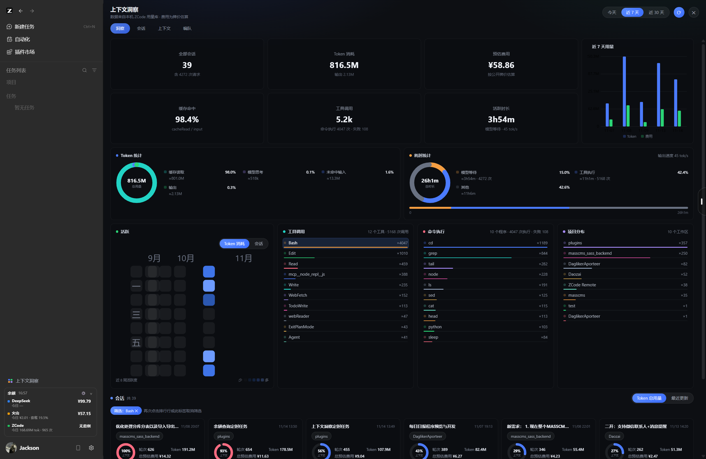
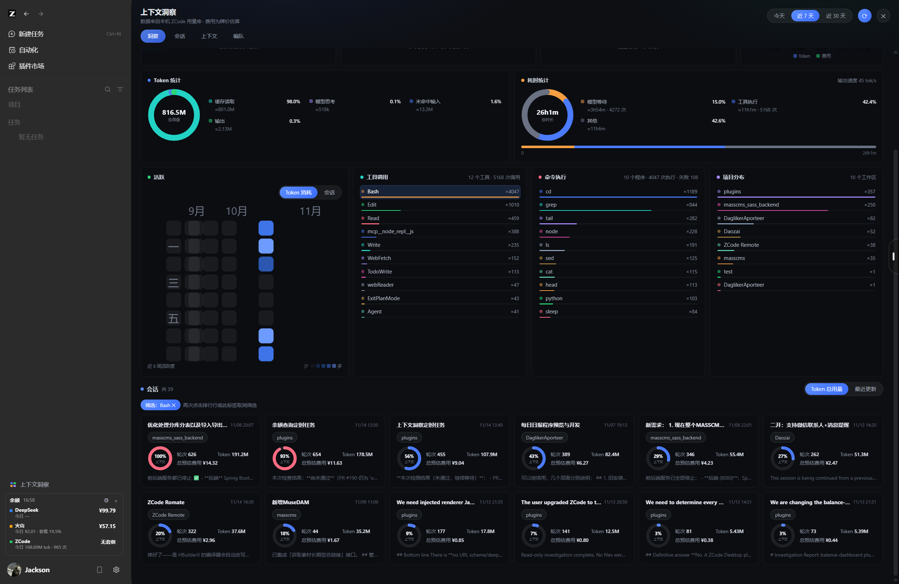
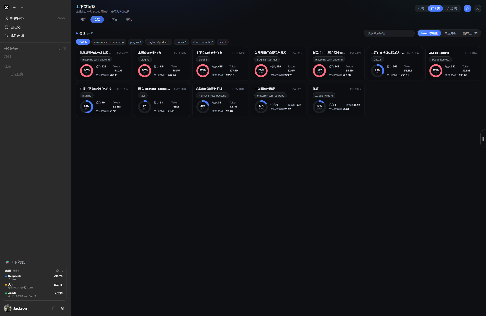
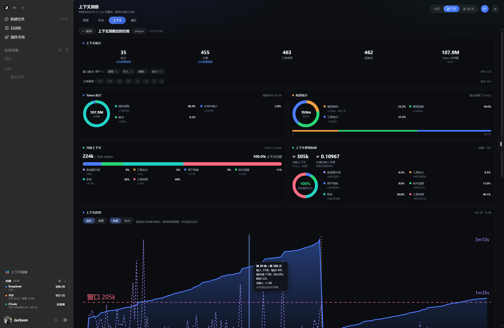
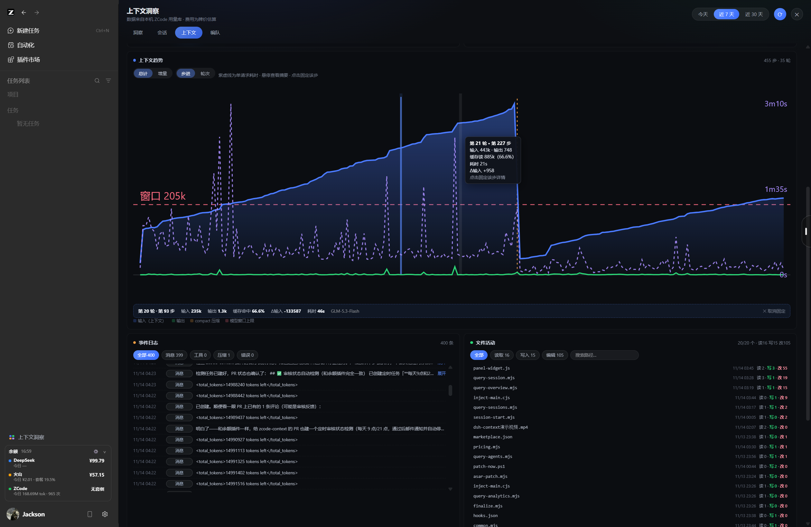
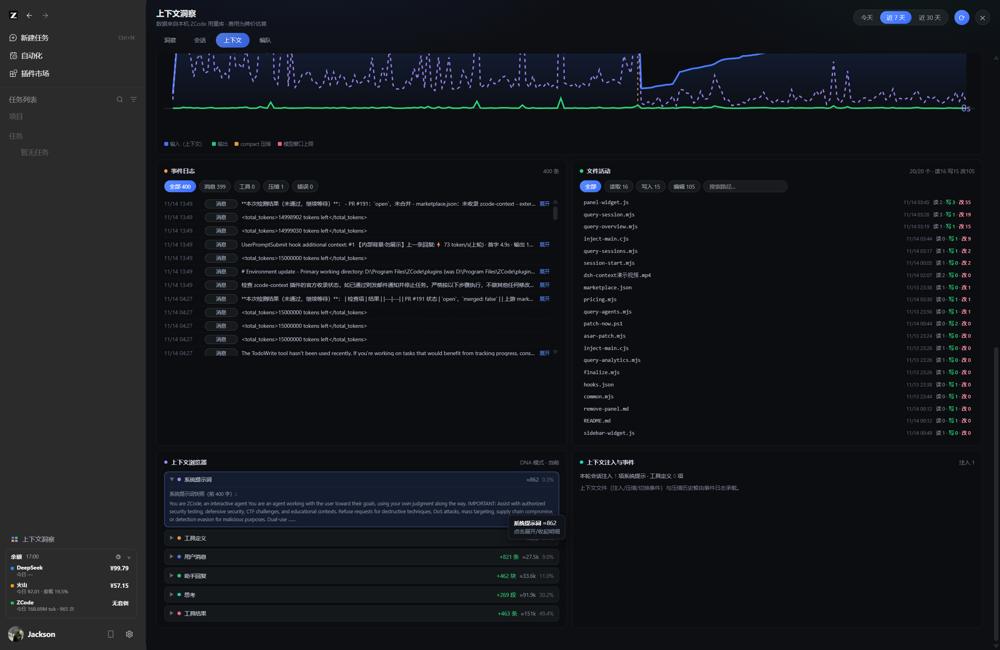
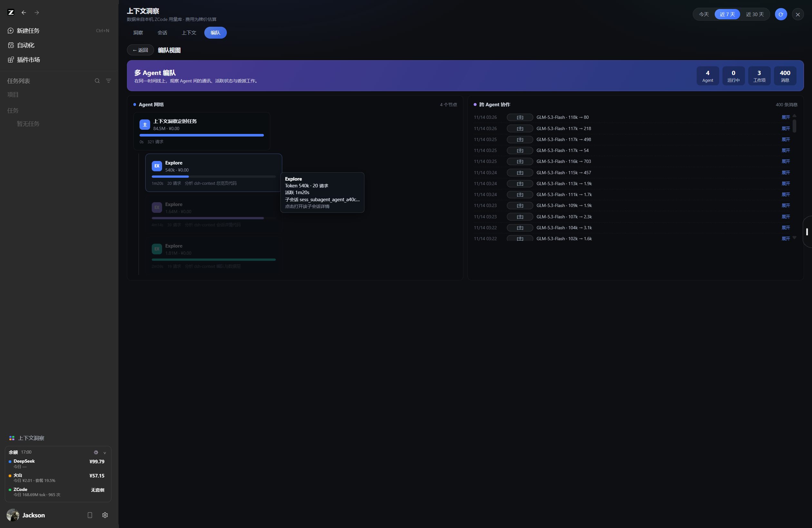

<div align="center">

# 🧠 zcode-context · 上下文洞察 (Context Insight)

**A context-usage insight dashboard for [ZCode](https://zcode.ai) — inspired by [dsh-context](https://github.com/bowenliang123/dsh-context) for DeepSeek Harness.**

[](#安装)
[](./LICENSE)
[](#)
[](https://github.com/zai-org/zcode-plugins)
[](https://github.com/AwenJackson/zcode-context/stargazers)

*ZCode 上下文洞察仪表盘 · Token 统计 / 费用估算 / 缓存命中率 / 上下文浏览器 / Agent 编队 · 纯本地数据，无需其他插件，无需系统 Node.js*

</div>

---

## 📸 界面导览 / Screenshots

插件共四个视图：**洞察（总览）→ 会话 → 上下文（单会话详情）→ 编队**。以下按页面逐一说明。

### 图 1 · 洞察页 — KPI 总览与用量趋势（Overview · KPIs & Usage）



- **六张 KPI 卡**（顶部居中）：全部会话（含总请求次数）、Token 消耗（含输出量）、预估费用（按公开牌价估算）、缓存命中率（`cacheRead / input`，越大说明缓存复用越好、费用越低）、工具调用（含命令执行成功与失败次数）、活跃时长（模型等待 + 输出速度 tok/s）。
- **近 7 天用量图**（右上）：Token（蓝柱）+ 费用（绿柱）双柱对照，横轴为日期；**悬停任意柱**会弹出摘要：日期、Token 总量、费用、请求次数。
- **Token 统计环形图**：总量居中，环形按 缓存读取 / 模型思考 / 未命中输入 / 输出 / 缓存写入 五类拆分；右侧图例给出每类的占比与 ≈值，**悬停分段或图例会互相高亮联动**。
- **耗时统计环形图**：总时长居中，按 模型等待（Σ首字延迟）/ 模型思考 / 模型回复 / 工具执行（请求间隙估算）/ 其他 拆分，图例附次数口径；下方时间轴条直观显示各段占比。
- **时间范围切换**（右上角）：今天 / 近 7 天 / 近 30 天；⟳ 刷新、✕ 关闭。
- 顶部四个视图 Tab：**洞察 · 会话 · 上下文 · 编队**。

### 图 2 · 洞察页 — 热力图 / 排行 / 会话卡片（Overview · Rankings & Sessions）



- **活跃热力图**：近 8 周活跃度，按天着色，支持 **Token 消耗 / 会话** 双指标切换；**悬停显示当日会话数与 Token 量，点击格子可筛选当天的会话卡片**。
- **工具调用排行**：按调用次数排序（图例：Bash ×4047、Edit ×1010、Read ×459…），行内附彩色占比条；**悬停显示次数与占比，点击行会在下方出现「筛选：Bash ✕」chip，把会话卡片过滤到使用过该工具的会话；再次点击行或点 chip 取消**。
- **命令执行排行**：取 Bash/PowerShell 命令首词统计（cd ×1189、grep ×844…），并显示总执行次数与失败次数。
- **项目分布**：按工作区聚合的 Token 排行，同样支持点击筛选。
- **会话卡片**：标题、时间、工作区 chip、迷你上下文占用环（≥85% 变红）、轮次 / Token / 费用、最近消息摘要；卡片底部的「筛选」chip 显示当前生效的筛选条件。

### 图 3 · 会话页（Sessions）



- **搜索框**：按标题模糊搜索；**工作区 chips**：全部 12 / masscms_sass_backend 4 / plugins 3 …，点击即过滤。
- **三种排序**：Token 总用量 / 最近更新 / 当前上下文（上下文占比从高到低，快速找出快爆窗口的会话）。
- **每张卡片**：迷你环形图中心直接显示当前上下文占用百分比（如 100%、93%、52%），占用 ≥85% 环变红色预警；右侧显示 轮次、Token、总预估费用。
- 点击任意卡片进入该会话的 **上下文** 详情页。

### 图 4 · 上下文页 — 统计头卡与构成（Context · Stats & Composition）



- **上下文统计头卡**：轮次（点击查看趋势）、步骤（点击查看趋势）、工具调用、回复块、Token 总用量 + 费用。
- **输入输出行**：用户 / 读取 / 写入 / 搜索 / 命令的可点击 chip —— **点击「读取」会滚动到文件活动卡并切到「读取」筛选；工具调用行同理，点击某工具名会把事件日志过滤到该工具**。
- **Token 统计**：本会话的缓存读取 / 未命中输入 / 输出拆分与缓存命中率。
- **耗时统计**：模型等待 / 模型回复 / 工具执行的三段环形 + 时间轴。
- **当前上下文条**：当前窗口占用（如 224k / 205k tokens），分段显示六类构成占比，末段为斜纹的**压缩预留区**；**悬停分段显示「≈值 · N% 占已用」，点击分段会滚动到下方上下文浏览器对应分组并自动展开**。
- **上下文费用构成**：把当前上下文按六类 token 乘以最近模型牌价估算为 CNY，环形图 + 逐类百分比（悬停显示 ≈tokens × 单价 = ¥ 口径）。
- **上下文趋势**：总计 / 增量 × **步进 / 轮次** 四种组合切换；蓝线=输入（上下文规模）、绿线=输出、紫虚线=单请求耗时、红虚线=模型窗口上限、琥珀虚线=compact 压缩点。**悬停任意步骤弹出「第 T 轮 · 第 S 步」摘要（输入/输出/缓存命中率/耗时/Δ增量），点击可固定该步详情**（见图 5 底部横条）。

### 图 5 · 上下文页 — 趋势固定详情 / 事件日志 / 文件活动（Context · Trend Detail, Events & Files）



- **RequestDetail 固定条**（趋势图下方）：点击趋势图某一步后固定显示「第 20 轮 · 第 83 步 · 输入 235k · 输出 1.3k · 缓存命中 66.6% · Δ输入 −133587 · 耗时 46s · 模型名」，点 ✕ 取消固定。
- **事件日志**：类型筛选胶囊 **全部 400 / 消息 399 / 工具 0 / 压缩 1 / 错误 0**（dsh `toggleKind` 行为）；每行显示时间、类型标签、内容，**行点击展开全文**，长文本有「展开」提示。
- **文件活动**：头标签兼筛选 **全部 / 读取 16 / 写入 15 / 编辑 105** + **路径搜索框**；每行显示文件名、最后操作时间、读/写/改计数（写绿色、改红色），**行点击展开完整路径与操作明细**。
- 悬停任意元素均显示口径摘要 tooltip。

### 图 6 · 上下文页 — 上下文浏览器（Context · Browser, DNA 模式）



- **七分组可折叠列表**（对齐 dsh 上下文浏览器）：系统提示词 / 工具定义 / 用户消息 / 助手回复 / 思考 / 工具结果 / 注入内容。
- 每组显示 ≈Token 与占比，消息类组带 **`+N 条` 绿色 delta 徽标**（如 +821 条、+462 块、+269 段、+463 条）。
- **系统提示词组展开后显示快照前 400 字**（来自 `runtime/prompt_snapshot`）；**工具定义组展开显示全部工具名清单**。
- **组与上方「当前上下文条」双向联动**：悬停任一侧，对应分段/分组互相高亮。
- 右侧「上下文注入与事件」卡：本轮会话注入的系统提示词与工具定义条目数。

### 图 7 · 编队页（Formation）



- **渐变横幅**：多 Agent 编队统计 —— Agent 数 / 运行中 / 工作项 / 消息数。
- **Agent 网络**：主会话节点（蓝「主」徽标）+ 子 Agent 树（缩进连线），每张节点卡含彩色徽标、Token / 费用、占用进度条（≥70% 琥珀、≥90% 红）、活跃时长与请求数。
  - **悬停子节点会点亮父链**：其余节点降透明，仅主节点与该子节点保持高亮；
  - **悬停弹出详情 tooltip**（Token、请求、活跃、子会话 id）；
  - **点击子节点直接打开该子会话的上下文详情**（子会话真实存在于本地库）。
- **跨 Agent 协作**：按时间列出主/子 Agent 的每次请求事件（模型、输入 → 输出 token），行点击展开。

---

## ✨ 数据亮点 / Highlights

- **全局悬浮摘要**：所有图表（环形分段、用量柱、热力格、排行行、趋势点）悬停 140ms 后弹出统计口径 tooltip。
- **点击下钻**：排行行 → 会话筛选；热力格 → 按天筛选；KPI 卡 → 跳转对应视图；趋势点 → 固定单步详情；上下文条分段 → 浏览器分组；编队节点 → 子会话详情。
- **缓存命中率** = cacheRead / (input + cacheRead + cacheWrite)，与 dsh-context 口径一致。
- **耗时分解**：模型等待 = Σ首字延迟(ttft)；思考/回复按 reasoning/output token 占比从生成时长拆分；工具执行 ≈ 请求间隙（≤10 分钟）；其他 = 活跃时长 − 上述。
- **费用**：内置牌价表（DeepSeek / GLM / 豆包系列）× USD→CNY 7.2 估算，未收录模型用保守默认价，界面统一标注「估算」。
- **上下文构成**：按字符数 ÷ 3.5 启发式估算 token，界面明确标注「估算」；单请求精确值以 `model_usage.input_tokens` 为准。

## 📦 安装 / Install

**方式一：本地插件市场**
1. Clone 本仓库到任意目录，例如 `D:\plugins\zcode-context`
2. ZCode → 插件市场 → 添加 → 添加插件市场，填入该目录
3. 安装 **上下文洞察 (zcode-context)**，**完全退出并重开 ZCode**（含托盘进程）
4. 左侧边栏底部出现「上下文洞察」入口

**方式二：从 GitHub 安装（待官方市场收录后可用）**
```
# ZCode 插件市场 → 添加 → GitHub 仓库
https://github.com/AwenJackson/zcode-context
```

> 安装/更新后需要重启 ZCode：插件通过 `app.asar` 注入侧边栏入口与面板（带完整性校验与自动备份，可用 `/remove-panel` 一键卸载）。

## 🧰 原理与隐私 / How it works & Privacy

- 数据全部来自本机 ZCode SQLite（`~/.zcode/cli/db/db.sqlite` 的 `model_usage` / `session` / `part` / `message` / `prompt_snapshot` 表）与 `~/.zcode/cli/agents/<id>/` 子代理元数据，**只读、零网络请求、不上报**。
- 无需其他插件；**无需系统 `node` 命令**（使用 Electron 内置 Node 运行时 `ELECTRON_RUN_AS_NODE=1`）。
- 磁盘缓存 + 后台刷新 + 启动预取：打开面板即出数据。
- 注入状态写在 `~/.zcode/zcode-context/runtime/status.json`，日志在 `inject.log`；卸载：`/remove-panel` 或 `node scripts/unpatch.mjs`。
- 上下文窗口按模型 id 查内置表（DeepSeek V4 系 1M、GLM 200K、豆包 256K 等），未收录模型按 128K 保守估计。

## 🏷 关键词 / Keywords
`zcode` · `zcode-plugin` · `context-window` · `token-usage` · `token-statistics` · `cost-estimation` · `llm-observability` · `dashboard` · `context-insight` · `agent-monitoring` · `dsh-context` · `deepseek` · `glm` · `sqlite` · `electron`

## 📄 License
[Apache License 2.0](./LICENSE) · 灵感与交互设计参考 [dsh-context](https://github.com/bowenliang123/dsh-context)（感谢 [@bowenliang123](https://github.com/bowenliang123)）
