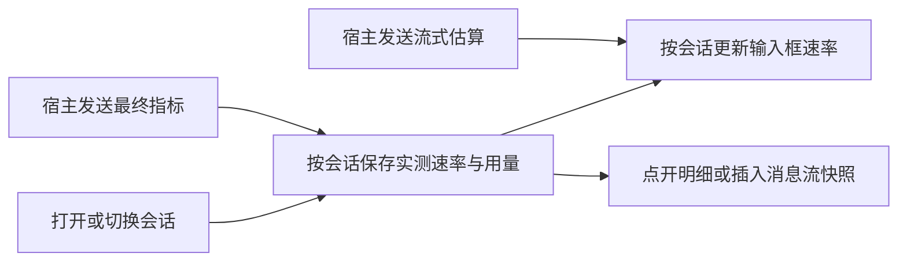
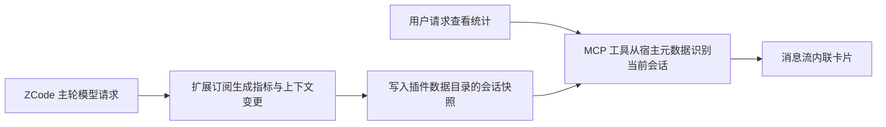

# Token 统计插件规格

## 会话输入框状态

桌面本地会话在输入框工具栏的上下文圆环左边常驻 Token 指标。没有测量值时显示占位。宿主在生成过程中按流式事件更新估算速度，工具栏直接显示数值，悬停说明标记为估算。收到服务商的最终指标后更新为实测速度，并增加已观测的输出累计。中断或缺少最终指标时，保留最近一次估算并继续标为估算。累计仅使用已确认的请求。切换会话后显示目标会话的指标，从磁盘恢复已确认记录。窄窗口按宿主规则收起文字并保留入口。悬停时在状态上方显示 Token 明细，使用消息流卡片的同一份数据。提示逐行显示模型、速度、最近输出、首 Token 用时、输出合计、上下文输入。生成中仅速度更新为估算，其他指标仍显示已确认的数据。点击状态可在侧栏看明细快照。

## 插入卡片

ZCode Desktop 本地工作区会话中，用户可以选择斜杠命令 `/show-token-stats`，也可以让 Agent 直接调用 `show_token_stats`。宿主将这次调用的结果作为 MCP App 嵌进消息流。页面只声明 `inline` 模式，历史卡片显示创建时的快照。当前扩展插槽目录没有助手消息尾部插槽，自动逐消息插卡需要宿主增加支撑。

## 统计口径

- 最近一次输出速度、输出 Token 和首 Token 时间直接使用宿主的 `models.onDidGenerate` 最终事件。速率按生成时段计算，扣除首 Token 等待。没有准确速率的请求不会出现在这个事件中。
- 输出累计最多覆盖最近 20 次收到准确指标的主轮请求。一个请求 ID 只在窗口内计一次。同一用户轮可以有多次模型请求。标题、压缩与子代理由宿主排除。
- 上下文输入取 `context.get` 的最近已上报请求快照中的 `providerInputTokens`。这和生成指标独立更新。两项可能来自不同请求，因此各自标注，分别展示。宿主只返回预演或缺少实际输入值时，卡片显示「暂无实测数据」。同一毫秒内的不同请求按宿主修订号排序。
- 指标从插件开始收到事件时采集。工具调用使用当时已落盘的快照，可能包含为发起该工具调用而生成的模型请求。缺失数据保留为空，已上报的零值原样显示。
- 数据写入 `ctx.extension.dataPath`，MCP 从同一个 `ZCODE_PLUGIN_DATA` 读取。按宿主提供的会话 ID 隔离。工具没有会话参数，页面只接收数字和模型名，不读取本地数据目录。

## 验收

在隔离配置加载插件。用两条带 usage 的模型响应生成指标，再调用 `show_token_stats`。检查工具行中的内联卡片、速率和输出合计。切换到没有观测数据的会话时检查空状态。深浅主题与中英文跟随宿主。另检查重复 ID、跨会话隔离、原子写入和重开后的可读性。输入框验证占位、流式多次更新、最终值、会话切换、重载后的恢复，以及悬停显示完整明细、点击打开侧栏。
